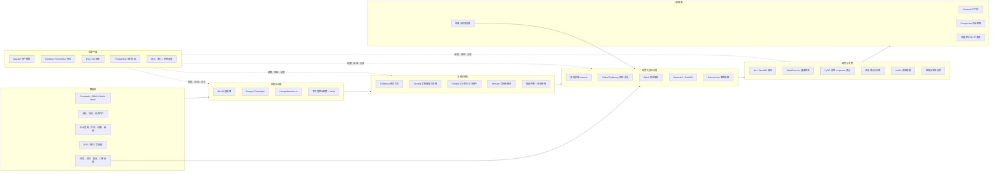
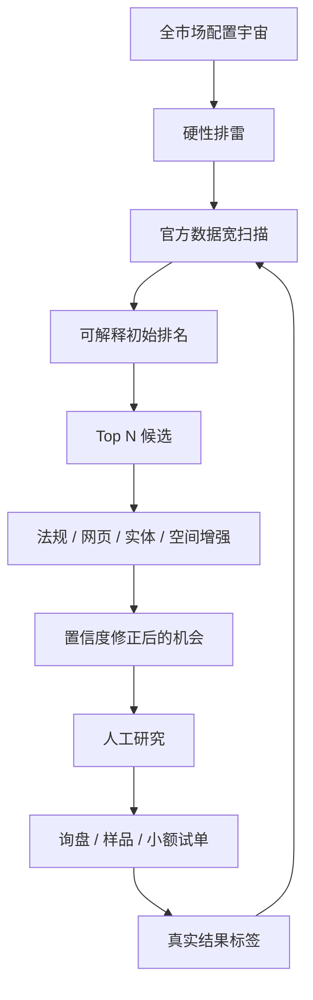
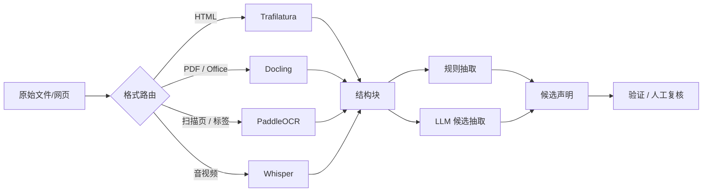
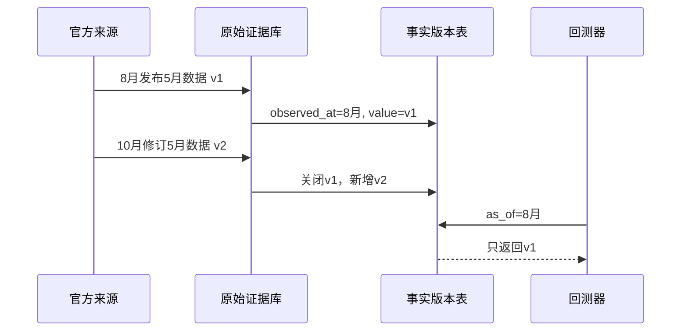
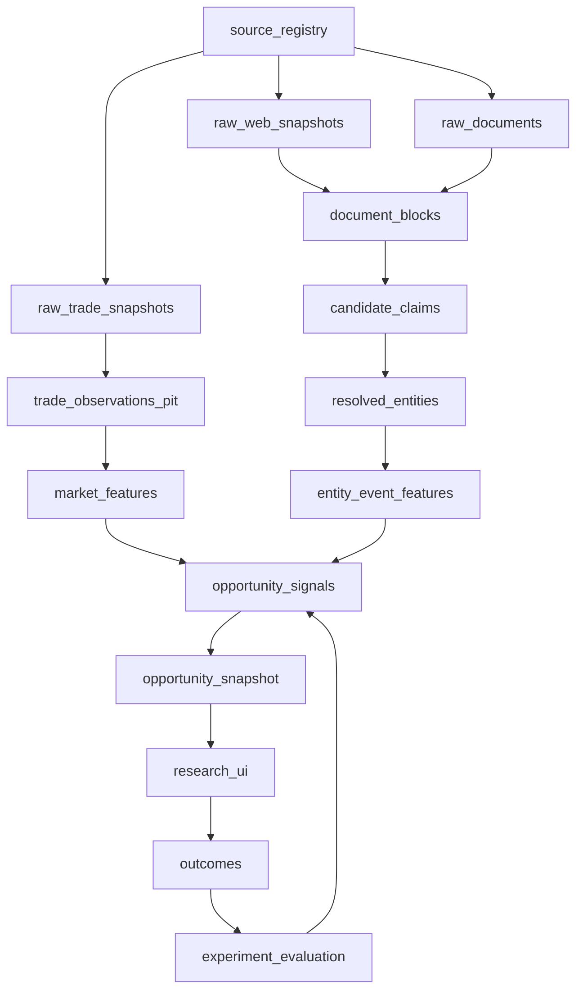
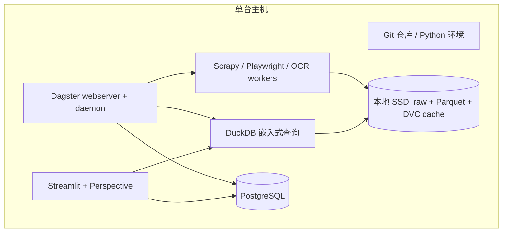

# 全球贸易 Alpha 基站 PoC：完整技术架构

日期：2026-08-24  
定位：一套单机可运行、可审计、可回放、可扩展的多模态贸易机会研究系统。  
核心目标：不预先拍脑袋指定产品，让系统从一个配置化商品—国家宇宙中进行广泛扫描，再把昂贵的数据采集和人工研究集中到少量候选机会。

---

## 1. PoC 要回答什么

PoC 不是证明“AI 能预测爆品”，而是证明以下闭环可以成立：

1. 能持续取得结构化和非结构化贸易证据；
2. 所有数据都有来源、抓取时间、内容 hash 和版本；
3. 公司、工厂、商品、国家、文件和事件能被连接；
4. 任一历史日期都能还原“当时实际知道什么”；
5. 系统能从广泛商品宇宙生成可解释的机会排名；
6. 每个分数都能下钻到特征、事实、声明和原始证据；
7. 后续询盘、样品、报价和成交能反馈为私有标签；
8. 相同代码、配置和数据版本可以重放相同结果。

### PoC 的非目标

- 不做全自动外贸公司；
- 不让大模型直接决定投钱；
- 不一开始建立全球公司全量数据库；
- 不同时部署多套湖仓、编排器和数据目录；
- 不追求高频、实时或大规模分布式计算；
- 不在第一阶段自动向外部客户发送邮件或下单。

---

## 2. 总体架构



架构被划分为四个逻辑平面：

- **证据平面**：任何外部输入先以原貌保存；
- **知识平面**：把证据转换成带来源的声明、实体、关系和事实；
- **研究决策平面**：计算特征、信号、排名、组合和回测；
- **控制平面**：负责调度、质量、血缘、版本、权限和审计。

---

## 3. PoC 的范围：宽扫描，窄增强

为了避免重新落入“先选三个产品”，PoC 使用两阶段漏斗。

### 阶段 A：宽扫描

配置一个可负担的市场宇宙，例如：

- 一组目标进口市场；
- 所有允许进入的 HS4 商品类别；
- 至少覆盖完整季节周期的月度历史；
- 明确排除的商品章节、法规等级和物流类型。

这一阶段只依赖官方结构化数据，成本低、覆盖广。输出是 `HS4 × 进口国 × 月份` 的候选矩阵。

### 阶段 B：窄增强

只对宽扫描排名靠前的候选继续投入昂贵计算：

- 下钻到 HS6；
- 读取关税和法规文件；
- 监控企业官网和采购门户；
- 解析 PDF、图片和网页变化；
- 解析企业、工厂、买家和关系；
- 进行人工验证、询价或小额试验。



这样既不需要人预先决定产品，也不会为了几千个低价值候选抓取整个互联网。

---

## 4. 开源项目如何拼接

## 4.1 数据源适配层

| 来源 | 使用项目 | 拼接方式 | 输出 |
|---|---|---|---|
| UN Comtrade | [comtradeapicall](https://github.com/uncomtrade/comtradeapicall) + dlt | 官方客户端负责查询；外层 dlt 负责分页/批次、增量状态、重试和落地 | 原始 JSON/CSV、查询参数、元数据、批次清单 |
| World Bank | [wbgapi](https://github.com/tgherzog/wbgapi) + dlt | 取得宏观、人口、基础设施等辅助变量；统一包装成 source asset | 原始响应和 tidy observation |
| 使用 SDMX 的统计机构 | [sdmx1](https://github.com/khaeru/sdmx) + dlt | sdmx1 解析结构和数据；dlt 管增量、schema drift 和目的地 | SDMX 结构版本、序列、观测值 |
| WTO/WITS/其他 REST API | dlt REST source | 为每个 API 写薄连接器，不复制通用分页和状态代码 | 原始响应、规范化表 |
| 政策/采购/新闻静态网页 | Scrapy + Trafilatura | Scrapy 负责请求/重试；Trafilatura 提取正文和页面元数据 | HTML 快照、正文、链接、发布时间 |
| 动态网页和下载门户 | Playwright | 浏览器只负责必要交互、下载和网络响应捕获 | HTML、截图、下载文件、请求日志 |
| 企业网站变化 | changedetection.io | 监控 URL；变化事件触发 Dagster 解析任务 | before/after 快照、diff、首次发现时间 |
| PDF/Office/扫描件 | Docling + PaddleOCR | Docling 解析结构；扫描页或疑难区域交给 PaddleOCR | page/block/table/image、bbox、reading order |
| 音视频 | Whisper | 只对选定来源转录；保留时间戳和原始媒体引用 | transcript segment、语言、时间段 |

### 连接器统一接口

无论来源是什么，连接器都必须返回同一信封：

```yaml
source_id: wto_tbt
request_id: uuid
source_url: https://...
retrieved_at: 2026-08-24T10:30:00Z
published_at: 2026-08-20T00:00:00Z
event_period: 2026-08
content_type: application/pdf
http_status: 200
content_hash: sha256:...
license_policy_id: wto-public-v1
parser_hint: regulatory_notice
raw_uri: raw/wto_tbt/2026/08/24/<hash>.pdf
```

连接器不负责业务判断。它只负责可靠取得证据、记录上下文并保证幂等。

## 4.2 原始证据层

原始证据采用 append-only，不允许解析器覆盖源文件。

```text
data/
  raw/
    <source_id>/year=YYYY/month=MM/day=DD/<content_hash>.<ext>
  manifests/
    <source_id>/retrieval_date=YYYY-MM-DD/*.parquet
  bronze/
    extracted_blocks/
    extracted_tables/
    extracted_media/
  silver/
    claims/
    entities/
    relationships/
    observations/
    events/
  gold/
    features/
    signals/
    opportunities/
    backtests/
```

工具分工：

- **Parquet/Arrow**：批量事实、声明、特征和结果；
- **DuckDB**：直接查询 Parquet，构建研究数据集；
- **PostgreSQL**：任务状态、人工复核、配置、用户、注释和最新操作状态；
- **DVC**：版本化有限的基准样本、标注集、模型产物和研究快照；
- **Git**：代码、schema、配置、dbt 模型和实验定义；
- **lakeFS**：迁移到对象存储以后再引入，不是 PoC 前置条件。

## 4.3 多模态解析层

解析不是一次性的“文档转文本”，而是保留结构和坐标：



每条模型抽取结果必须包含：

- `artifact_id`；
- 页码、段落、表格单元格、bbox 或音频时间段；
- 抽取器及版本；
- prompt/schema 版本；
- 置信度；
- 原始文本或图像区域引用；
- 审核状态。

LLM 只能写入 `candidate_claim`，不能直接写入经过确认的事实表。

## 4.4 实体、声明和关系层

以 FollowTheMoney 的调查数据思想为底座，增加贸易领域实体。

### 核心实体

- `Organization`：进口商、出口商、品牌、贸易商、监管机构；
- `Facility`：工厂、仓库、港口、实验室；
- `Person`：联系人、董事、实际控制人；
- `ProductClass`：HS 版本和层级；
- `Product`：企业 SKU、目录产品、标准化规格；
- `Place`：国家、地区、港口、H3 单元；
- `Document`：法规、检测报告、目录、招标文件；
- `Event`：政策、禁令、罢工、灾害、扩产、招聘、招标；
- `TradeFlow`：报告国、伙伴、商品、方向、期间及统计值；
- `Experiment`：研究、询盘、样品和试单。

### 核心关系

- `owns`、`operates`、`located_at`；
- `supplies`、`imports_from`、`exports_to`；
- `produces`、`classified_as`；
- `mentioned_in`、`affected_by`；
- `same_as`、`subsidiary_of`；
- `participated_in`、`awarded_contract`。

### 实体解析流程

1. 规则标准化：大小写、公司后缀、国家、电话、域名、地址；
2. 阻塞候选：域名、国家、邮编、名称 token、地址 H3；
3. Splink 计算概率匹配；
4. 高置信自动链接，中间置信进入 OpenRefine/Streamlit 人工队列；
5. 所有合并保留依据、阈值、模型版本和撤销能力；
6. NetworkX 计算关系网络特征；需要空间查询后加入 PostGIS/H3。

不要直接把两条记录物理合并。使用稳定 `entity_id` 和可版本化 `same_as` 决策。

---

## 5. 时间与版本模型

贸易研究最容易出现的致命错误是回测使用了当时尚未公布或后来修订的数据。

每条事实至少具有以下时间：

| 字段 | 含义 |
|---|---|
| `event_time` / `event_period` | 现实世界事件或统计所属时间 |
| `published_at` | 来源宣称的发布日期 |
| `observed_at` | 系统首次观察到该信息的时间 |
| `retrieved_at` | 本次取得原始证据的时间 |
| `valid_from` / `valid_to` | 该事实在现实世界中的有效区间 |
| `system_from` / `system_to` | 该版本在系统中的生效区间 |

### Point-in-time 规则

历史日期 `T` 的研究数据只能使用：

```text
observed_at <= T
AND system_from <= T
AND (system_to IS NULL OR system_to > T)
```

修订不覆盖旧值，而是关闭旧版本并增加新版本。



---

## 6. 物理数据模型

### 6.1 控制与来源表（PostgreSQL）

| 表 | 关键字段 | 用途 |
|---|---|---|
| `source_registry` | source_id, owner, access_method, terms_url, data_license, robots_policy, retention_policy | 数据来源与合规登记 |
| `ingestion_run` | run_id, source_id, started_at, status, cursor_before/after, code_sha | 一次采集运行 |
| `artifact_manifest` | artifact_id, content_hash, raw_uri, mime_type, retrieved_at, request_id | 原始证据索引 |
| `extraction_run` | artifact_id, parser, parser_version, model, schema_version, status | 解析审计 |
| `review_task` | task_id, claim_id/link_id, reviewer, decision, reason | 人工复核队列 |
| `experiment_registry` | experiment_id, universe_version, feature_set, label, cost_model, code_sha | 研究登记 |

### 6.2 证据与知识表（Parquet，DuckDB 查询）

| 表 | 粒度 | 说明 |
|---|---|---|
| `raw_snapshot_index` | 一次获取的一个内容版本 | URL、hash、状态、时间、文件位置 |
| `document_block` | 文档结构块 | 页、bbox、文本、表/图类型、父子关系 |
| `claim` | 来源对某实体属性/关系的一次声明 | subject、predicate、object、evidence、confidence |
| `entity` | 稳定实体 ID | 类型和当前规范显示名 |
| `entity_alias` | 一个来源中的别名 | 原始名称、语言、标准化名称 |
| `entity_link` | 两条记录的解析决策 | probability、method、model_version、review_status |
| `relationship` | 实体间有时间和来源的关系 | type、from/to、validity、evidence |
| `event` | 一个结构化现实事件 | type、actors、places、products、severity、evidence |
| `trade_observation` | reporter×partner×flow×HS×period×vintage | value、quantity、unit、flag、版本时间 |

### 6.3 研究与决策表

| 表 | 粒度 | 说明 |
|---|---|---|
| `feature_value` | opportunity×as_of×feature_version | 数值、缺失状态、来源覆盖、置信度 |
| `signal` | opportunity×as_of×signal_version | 方向、强度、有效期、解释 |
| `opportunity_snapshot` | HS×market×buyer_type×as_of | 总分、分项、排名、硬性排除原因 |
| `allocation` | experiment×opportunity | 研究时间、样品预算、库存/信用额度 |
| `decision` | 一次人或系统决策 | 输入快照、行动、负责人、理由 |
| `outcome` | 行动后的真实反馈 | 回复、RFQ、报价、样品、订单、毛利、回款、质量 |
| `backtest_result` | strategy×fold×horizon | 预测、排序、成本、稳定性和暴露指标 |

---

## 7. dbt 分层和特征计算

```text
models/
  staging/
    stg_comtrade.sql
    stg_sdmx.sql
    stg_claims.sql
    stg_entities.sql
  intermediate/
    int_hs_concordance.sql
    int_trade_point_in_time.sql
    int_entity_resolved.sql
    int_event_product_country.sql
  marts/
    fct_trade_monthly.sql
    fct_entity_events.sql
    dim_product_hs.sql
    dim_entity.sql
    bridge_entity_resolution.sql
  features/
    feature_market_monthly.sql
    feature_supplier_structure.sql
    feature_policy_event.sql
    feature_data_confidence.sql
  signals/
    signal_market_opportunity.sql
```

### 第一代特征

| 组 | 示例 | 说明 |
|---|---|---|
| 需求 | 3/6/12 月增速、增长加速度、季调偏离 | 不只看 CAGR |
| 市场容量 | 进口额、数量、买家/供应来源覆盖 | 防止小基数假增长 |
| 供应结构 | HHI、Top-1/Top-3 份额、供应商更替 | 识别垄断与供给冲击 |
| 中国缺口 | 中国份额及趋势、同类市场基准差 | 不能把低份额自动当机会 |
| 价格 | unit value、离散度、来源国差价、异常 | unit value 不是实际成交价，必须标注代理性质 |
| 稳定性 | 波动率、缺失率、修订率、异常频率 | 同时衡量市场风险和数据风险 |
| 政策事件 | 关税、TBT/SPS、禁令、生效窗口 | 来自结构化数据和文件抽取 |
| 执行摩擦 | 认证、易碎/危险、MOQ、物流、售后 | PoC 初期可用规则和人工标注 |
| 实体/网页 | 扩产、招聘、目录变化、招标、新设施 | 只对窄增强候选计算 |
| 数据置信 | 来源权威度、时效、交叉验证、抽取置信 | 分数必须随数据质量折扣 |

每个特征必须登记：

- 定义和单位；
- 观察窗口与预测 horizon；
- point-in-time SQL；
- 所需来源；
- 缺失处理；
- 版本；
- 预期方向；
- 适用商品/国家范围。

---

## 8. 信号、排名和组合配置

### 8.1 硬性排雷先于模型

先根据用户 mandate 配置排除条件：

- 禁止/限制商品；
- 高认证和高责任风险；
- 危险品、电池、医疗、食品等是否允许；
- 最小市场容量；
- 最大波动、国家风险和账期；
- 最大物流体积/重量；
- 数据覆盖和可信度下限。

排除原因作为数据保存，不能只在代码里 `filter` 后消失。

### 8.2 透明初始评分

PoC 不从黑箱模型开始。第一版使用分组标准化后的透明分数：

```text
raw_alpha =
    demand_quality
  + supply_dislocation
  + price_opportunity
  + event_catalyst
  - regulatory_friction
  - execution_friction
  - market_volatility

confidence_adjusted_alpha = raw_alpha × data_confidence
```

权重是可版本化实验参数，不写死在 UI 中。

### 8.3 预测与异常工具

- **StatsForecast**：建立简单、可解释、强基线的面板预测；
- **PyOD**：发现跨特征异常，不把异常自动解释成机会；
- **ruptures**：检测需求、价格、份额和政策状态的结构变点；
- **DoWhy**：只有形成明确因果问题时使用，不作为日常排名引擎；
- **River**：积累真实反馈后用于在线更新与漂移检测。

### 8.4 资源配置

排名之后再用 skfolio/Riskfolio 思想分配有限资源：

```text
可配置资源 = 研究小时 + 供应商询价数 + 买家触达数 + 样品预算 + 试单额度
```

约束示例：

- 单一国家不超过总实验预算的某比例；
- 单一 HS 章节设暴露上限；
- 数据置信度低的机会只允许研究，不允许试单；
- 高相关机会不能重复占用大量预算；
- 每轮保留一部分探索预算给模型不确定但潜在上行大的候选。

---

## 9. 回测和真实实验

## 9.1 历史回测

回测单位是：

`opportunity = ProductClass × ImportMarket × BuyerType × as_of`

第一阶段可使用的代理标签：

- 未来 3/6/12 月进口价值或数量增长；
- 中国/目标供应国份额变化；
- unit value 的方向和稳定性；
- 候选是否持续进入后续排名；
- 出现负面政策或供应冲击的概率。

评估不只看均方误差：

- Top-K 命中率和 rank correlation；
- 分位数组合后续表现；
- 信号稳定性和衰减；
- 国家、商品和来源暴露；
- 数据缺失与修订敏感性；
- 加入研究/触达/样品成本后的净价值。

### 必须防止的泄漏

- 后来修订的数据；
- 当时未发布的法规生效信息；
- 使用未来企业名称或母子公司关系；
- 全样本归一化、去异常或填补；
- 先看未来赢家再定义 universe；
- 把抓取时间当成事件发生时间。

## 9.2 实盘式业务验证

真实反馈按事件进入系统：

```text
candidate_selected
→ supplier_researched
→ supplier_quote_received
→ buyer_contacted
→ reply_received
→ rfq_received
→ sample_sent
→ trial_order
→ repeat_order
→ payment_received
→ quality_issue
```

最终标签不是“是否成交”一个布尔值，而是漏斗、金额、时间、成本和风险的联合结果。

---

## 10. Dagster 资产图和运行频率



建议的触发策略：

| 资产 | 触发方式 |
|---|---|
| 官方月度贸易数据 | 按来源发布节奏 + 定期检查修订 |
| 新闻/政策页面 | 每日或来源事件触发 |
| 企业官网变化 | changedetection.io 变化事件触发 |
| 文档解析 | 新 artifact 到达后触发 |
| 实体解析 | 新增别名/地址达到批次阈值后触发 |
| 特征与机会榜单 | 上游资产更新后物化 |
| 回测 | 特征/标签/成本模型版本变化后触发 |
| 研究报告 | 榜单更新或人工请求 |

每个资产运行都记录 `code_sha + config_hash + input_snapshot_ids + output_hash`。

---

## 11. 研究终端

第一代 UI 用 Streamlit 组合 Perspective，不做复杂前后端。

### 页面 1：Universe 与排雷

- 当前 mandate；
- 商品/国家覆盖；
- 排除数量和原因；
- 数据新鲜度、缺失和修订状态。

### 页面 2：Opportunity Matrix

- 行：`HS × 市场 × buyer type`；
- 列：需求、供应、价格、政策、执行、数据置信和总分；
- Perspective 提供透视、排序、聚合和流式表格；
- 所有评分展示版本和 `as_of`。

### 页面 3：Opportunity Tear Sheet

- 历史走势和预测区间；
- 供应来源结构；
- 价格代理及异常；
- 政策、事件和网页变化时间线；
- 相关企业、工厂、买家和关系；
- 数据置信和风险；
- 每条结论的证据下钻。

### 页面 4：人工复核

- 实体匹配候选；
- 文档抽取候选声明；
- HS 映射候选；
- 接受、拒绝、修改及理由；
- 审核决定成为后续训练标签。

### 页面 5：实验与执行反馈

- 分配了多少研究/触达/样品预算；
- 漏斗转化、耗时、费用、毛利、回款和质量问题；
- 模型预测与实际结果的偏差。

---

## 12. 单机部署拓扑

PoC 推荐 Linux/WSL2 或一台 Linux 云主机。无需 Kubernetes。



### 为什么需要 PostgreSQL 和 DuckDB 两者

- PostgreSQL 管理频繁更新、事务性和多人操作的数据；
- DuckDB 管理研究型大扫描和 Parquet 分析；
- 不要把大量历史原始数据逐条塞进 PostgreSQL；
- 不要让 DuckDB 承担多人并发操作状态。

### 规模化路径

| 触发条件 | 变化 |
|---|---|
| 本地 SSD 不够或需要共享 | 原始/Parquet 迁移到 S3 兼容对象存储，引入 lakeFS |
| DuckDB 单机查询无法满足并发 | 评估 ClickHouse 或 Iceberg + Trino，二选一条主路线 |
| 数据资产和团队明显增多 | 引入 OpenLineage，再选择 DataHub 或 OpenMetadata |
| 文档/OCR 成为瓶颈 | 独立 worker 队列和可选 GPU；不改变数据契约 |
| 需要正式产品 API | 在研究层前增加 FastAPI 服务，不让 UI 直接访问存储 |

---

## 13. 推荐仓库结构

```text
trade-alpha-station/
  pyproject.toml
  uv.lock
  docker-compose.yml
  README.md

  config/
    sources/
    mandates/
    universes/
    scoring/
    policies/

  src/trade_alpha/
    connectors/
      comtrade/
      sdmx/
      world_bank/
      web/
    evidence/
    extraction/
    entities/
    geospatial/
    features/
    signals/
    portfolio/
    backtest/
    common/

  orchestration/
    assets/
    resources/
    sensors/
    schedules/

  dbt/
    models/
    macros/
    tests/
    seeds/

  apps/
    research_ui/

  contracts/
    jsonschema/
    pandera/
    frictionless/

  data/
    raw/
    manifests/
    bronze/
    silver/
    gold/

  experiments/
    definitions/
    reports/

  tests/
    fixtures/
    unit/
    contract/
    integration/
    point_in_time/
    golden_documents/
```

连接器、解析器、实体解析、特征和策略都通过插件式 registry 注册，不互相直接读取私有实现。

---

## 14. 数据质量与失败处理

### 入口质量

- HTTP 状态、MIME、大小、hash 和 schema 检查；
- API 行数、分页完整性和增量游标一致性；
- 文件打不开或 OCR 为空时进入 quarantine；
- Pandera 校验类型、范围、唯一键和业务约束；
- Frictionless 为外部批次生成可移交的数据包描述。

### 业务质量

- 贸易值非负，数量/单位组合可解释；
- reporter/partner/HS 代码必须存在于对应版本；
- 单价代理异常不能静默截断；
- 新旧发布差异超过阈值时生成 revision event；
- 实体自动合并必须超过经标注集校准的阈值；
- 文档声明没有证据坐标不得进入事实候选。

### 失败语义

- 原始证据取得成功但解析失败：保留 artifact，重跑解析；
- 连接器部分分页失败：整批标记 incomplete，不生成正式特征；
- schema drift：原始数据照常保存，silver 物化阻断并报警；
- 模型失败：不阻断事实层，只缺少该版本的信号；
- UI 不读取临时表，只读取成功发布的 snapshot。

---

## 15. 合规、安全和审计

每个来源必须先登记：

- 所有者和官方入口；
- API/网页/批量下载的允许方式；
- 软件许可与数据许可分别记录；
- robots、服务条款、速率限制；
- 商业使用、再分发和缓存限制；
- PII/敏感信息分类；
- 保存期限和删除流程；
- 是否允许将内容发送给外部模型服务。

安全要求：

- API key 和数据库密码不进 Git；
- 原始证据按 source policy 控制访问；
- 人工修改、实体合并和决策全部有审计记录；
- 页面抓取具备域名白名单、限速和停止开关；
- 浏览器 worker 与核心数据库隔离权限；
- LLM 输出按不可信输入处理并经过 schema 验证。

---

## 16. 测试体系

| 测试 | 目标 |
|---|---|
| 连接器 fixture 测试 | API 变化、分页、重试、游标和幂等 |
| 数据契约测试 | schema、类型、范围、主键、单位和枚举 |
| Golden document 测试 | 固定 PDF/图片的版面、表格、OCR 和证据坐标 |
| 实体解析标注集 | precision/recall、阈值和误合并成本 |
| point-in-time 测试 | 未来数据和修订数据无法泄漏 |
| 特征快照测试 | 同一输入版本得到同一特征 hash |
| 回测 walk-forward | 时间切分、成本和 universe 不泄漏 |
| 端到端 replay | 从固定 raw snapshot 重建相同机会榜单 |
| 恢复测试 | 中途失败后能够从 manifest 继续，不重复写入 |

---

## 17. 实施阶段

### Phase 0：工程骨架

- 建仓库、配置、日志、PostgreSQL 和目录；
- 接入 Dagster、DuckDB、Parquet、dbt-duckdb；
- 定义 source registry、artifact manifest 和时间字段；
- 完成一个假数据的端到端 replay。

### Phase 1：官方数据宽扫描

- Comtrade + 一个 SDMX/World Bank 来源；
- HS/country/time 维度和版本；
- 基础特征、硬性排雷、透明评分；
- Perspective 机会矩阵。

### Phase 2：非结构化增强

- 一类政策/采购网页和一类 PDF；
- Scrapy/Playwright、Trafilatura、Docling、PaddleOCR；
- artifact → block → candidate claim → evidence 下钻。

### Phase 3：实体与事件

- FollowTheMoney 风格实体；
- Splink 公司/设施解析；
- 网页变化和政策事件映射到商品与国家；
- 人工复核队列。

### Phase 4：研究与回测

- StatsForecast 基线；
- PyOD/ruptures 信号；
- point-in-time walk-forward；
- 特征、信号、成本和结果版本化。

### Phase 5：真实小额验证

- 将 Top 候选转成研究/询价任务；
- 记录供应商报价、买家回复、样品和试单；
- 使用私有结果重新评估特征和资源分配。

---

## 18. PoC 验收标准

PoC 只有同时满足以下条件才算成功：

1. 能从配置启动，不在代码中写死产品；
2. 至少接入一种官方结构化数据、一种网页和一种 PDF/图片数据；
3. 原始内容、hash、时间和许可策略可追溯；
4. 能展示同一数据的两个 vintage，并正确进行历史 as-of 查询；
5. 每条机会可以下钻到特征、事实、声明和原始证据；
6. 实体解析既支持自动匹配，也支持人工撤销；
7. 榜单包含排除理由、数据置信和风险，而不只有总分；
8. 回测使用 walk-forward，并通过专门的防泄漏测试；
9. 从固定 raw snapshot 可以重建相同榜单；
10. 至少能记录一次真实研究/询价/样品实验及其成本和结果。

如果只能生成漂亮榜单、不能回放历史、不能解释证据或不能接收真实反馈，就不是合格的 PoC。

---

## 19. 最终技术选择

### v0.1 确定采用

- Python + uv；
- Dagster；
- dlt；
- Comtrade API client、sdmx1、wbgapi；
- Scrapy、Playwright、changedetection.io；
- Trafilatura、Docling、PaddleOCR；
- FollowTheMoney 思想和 schema 扩展；
- Splink、NetworkX；
- Arrow/Parquet、Polars、DuckDB；
- PostgreSQL；
- dbt Core + dbt-duckdb；
- Pandera + Frictionless；
- DVC；
- StatsForecast、PyOD、ruptures、skfolio；
- Streamlit + Perspective。

### 暂缓

- Airflow、Prefect、Kestra：与 Dagster 功能重叠；
- ClickHouse、Trino、Iceberg、Delta Lake：规模尚未证明；
- DataHub、OpenMetadata：资产和团队尚小；
- Apache AGE/PostGIS/H3：有明确图/空间信号再启用；
- Whisper：出现高价值音视频来源再启用；
- Qlib、LEAN、Zipline：借鉴框架，不直接作为生产依赖；
- 向量数据库：PoC 先用全文、字段和证据定位，避免把 embedding 当事实库。

这套选择保留了未来迁移空间，但把第一代部署控制在少量服务和一台机器上。
