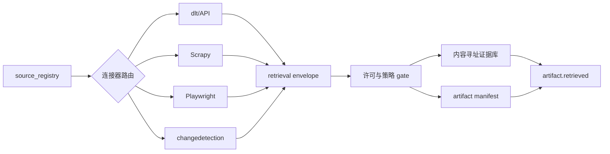

# M01：来源登记、采集与不可变证据

状态：Accepted for PoC design  
主组件：[dlt](https://github.com/dlt-hub/dlt)、[comtradeapicall](https://github.com/uncomtrade/comtradeapicall)、[sdmx1](https://github.com/khaeru/sdmx)、[wbgapi](https://github.com/tgherzog/wbgapi)、Scrapy、Playwright、changedetection.io  
上游：外部来源  
下游：M02、M04、M06、M10

## 1. 职责与边界

M01 负责：

- 登记来源、访问方式、许可和速率约束；
- 可靠获取 API、批量文件、网页、下载和页面变化；
- 保存请求上下文、响应元数据、原始 bytes 和内容 hash；
- 管理增量 cursor、分页、重试、幂等和不完整批次；
- 产生 `artifact.retrieved` 或 `retrieval.failed` 事件。

M01 不负责：

- 从文档中解释法规或商品；
- 合并企业身份；
- 计算业务特征；
- 评价机会好坏。

## 2. 内部架构



### 组件选择规则

| 场景 | 工具 | 规则 |
|---|---|---|
| 官方 REST/JSON/CSV API | dlt | 首选；连接器只实现来源特有鉴权和参数 |
| Comtrade | comtradeapicall + dlt wrapper | 官方客户端负责语义，dlt 负责运行状态和落地 |
| SDMX | sdmx1 + dlt wrapper | 同时保存结构定义版本和观测数据 |
| 静态站点 | Scrapy | 禁止无理由启动浏览器 |
| 必须 JS/交互/登录的公开入口 | Playwright | 捕获下载、HTML、截图和关键网络响应 |
| 已知 URL 的内容变化 | changedetection.io | 变化只触发采集；最终 artifact 仍由 M01 登记 |

## 3. Source Registry 契约

```yaml
source_id: un_comtrade
owner: United Nations
source_type: api
base_url: https://...
access_method: api
auth_class: subscription_key
rate_policy:
  max_requests_per_window: configured
  window_seconds: configured
robots_policy: not_applicable
terms_url: https://...
software_license: null
data_license: source-specific
commercial_use: review_required
redistribution: review_required
retention_policy: retain_raw
allowed_content_types:
  - application/json
  - text/csv
parser_profile: comtrade
owner_module: M01
status: enabled
```

没有完整 Source Registry 的来源不能启用正式调度。

## 4. Retrieval 与 Artifact 分离

- `retrieval` 表示一次获取行为；
- `artifact` 表示由内容 hash 标识的一份内容；
- 两次获取得到相同 bytes：产生两个 retrieval，但只引用一个 artifact；
- URL 内容变化：产生新 artifact，并建立 `supersedes` 关系；
- HTTP 304：保留 retrieval，引用现有 artifact；
- 错误页不得因 HTTP 200 被误认成正常文件，必须同时检查 MIME、签名和最小结构。

### Retrieval envelope

```yaml
retrieval_id: uuid
source_id: un_comtrade
request_fingerprint: sha256:...
request_url_redacted: https://...
request_method: GET
requested_at: 2026-08-24T10:30:00Z
retrieved_at: 2026-08-24T10:30:01Z
http_status: 200
response_headers_hash: sha256:...
content_hash: sha256:...
content_length: 123456
mime_type_detected: application/json
batch_id: uuid
page_number: 3
cursor_before: opaque
cursor_after: opaque
completeness_status: complete
code_sha: git-sha
connector_version: 1.0.0
```

## 5. 幂等、分页与增量

### 请求指纹

请求指纹由以下内容规范化后计算：

- source_id；
- endpoint 和不含 secret 的参数；
- 请求体；
- 时间分区；
- connector_version；
- universe/config version。

### 批次状态机

```text
planned → running → complete
                  ↘ incomplete → retrying → complete
                  ↘ blocked_policy
                  ↘ failed_terminal
```

只有 `complete` 批次可以触发 silver/gold 物化。`incomplete` 的 raw 数据仍保留。

### 增量策略

- cursor 在批次完全提交后更新；
- 新 cursor 和旧 cursor 同时写审计记录；
- 支持回看窗口以捕捉来源修订；
- 增量去重不得删除不同 vintage；
- 定期运行全量校验或抽样对账。

## 6. 原始证据目录

```text
raw/<source_id>/retrieved_date=YYYY-MM-DD/<sha256>.<ext>
manifests/retrievals/date=YYYY-MM-DD/part-*.parquet
manifests/batches/source=<source_id>/batch=<uuid>.json
```

原始文件名不依赖来源提供的文件名；原文件名作为 metadata 保存。写入流程必须采用临时文件、hash 验证、原子 rename/commit。

## 7. 失败语义

| 失败 | 行为 |
|---|---|
| 429/速率限制 | 尊重 Retry-After；指数退避；不丢 cursor |
| 5xx/网络中断 | 可重试；同一请求指纹不产生重复业务记录 |
| HTML 错误页伪装 200 | 保存 raw，标记 invalid_payload，不发布 |
| 分页中途失败 | 批次 incomplete，成功页面保留，恢复从安全 checkpoint 开始 |
| schema drift | raw 正常保存，发出 drift 事件，下游质量 gate 阻断 |
| 许可/条款状态不明 | blocked_policy；不可通过手工改数据库绕过 |
| 动态站点页面结构变化 | 保存截图和 HTML；选择器失败进入维护队列 |

## 8. 运行指标

- retrieval 成功率和延迟；
- 每来源新 artifact 比例；
- 重复内容率；
- 分页完整率；
- schema drift 次数；
- 429/403/5xx 比例；
- 原始字节增长；
- 来源新鲜度和最长滞后；
- blocked_policy 数量。

## 9. M01 独立验收标准

| ID | 优先级 | 场景 | 通过条件 | 验收证据 |
|---|---|---|---|---|
| M01-AC-001 | P0 | API 基本采集 | 从 fixture API 完成分页获取；manifest 数量与服务端声明数量一致 | batch manifest、测试日志 |
| M01-AC-002 | P0 | 幂等重跑 | 相同输入连续运行两次：retrieval 增加，artifact 和规范化自然键不重复 | 前后计数与 hash 报告 |
| M01-AC-003 | P0 | 中途恢复 | 在第 N 页注入失败后恢复；最终页面无缺失、无重复，cursor 仅在完整提交后前移 | 故障注入日志 |
| M01-AC-004 | P0 | 内容版本 | 同一 URL 依次返回 A、A、B；系统保存 2 个 artifact、3 个 retrieval，并正确建立版本关系 | manifest 查询结果 |
| M01-AC-005 | P0 | 原始不可变 | 尝试覆盖已有 hash 路径必须失败；重新解析不改变 raw 文件 hash | 文件完整性报告 |
| M01-AC-006 | P0 | 非法载荷 | HTTP 200 错误页、截断 JSON 和错误 MIME 均进入 quarantine，不能触发正式下游发布 | quarantine 清单 |
| M01-AC-007 | P0 | 许可 gate | 来源缺失商业使用/保留策略时，正式调度被阻断；补齐审核状态后才可运行 | policy 测试日志 |
| M01-AC-008 | P0 | Secret 脱敏 | URL、日志、manifest 和异常栈中均不存在 API key/token 明文 | secret scan 报告 |
| M01-AC-009 | P1 | 速率约束 | 模拟 429 和 Retry-After；实际请求间隔不违反登记策略 | 时间戳审计 |
| M01-AC-010 | P1 | 页面变化 | changedetection 发现变化后只采集一次新版本，并保留 before/after 引用 | 变化事件记录 |
| M01-AC-011 | P1 | 性能基线 | 在基准硬件和 fixture 数据量下达到事先记录的吞吐预算，且无内存无界增长 | benchmark 报告 |
| M01-AC-012 | P0 | 来源停用 | source 状态设为 disabled 后不再产生外部请求，但历史 artifact 仍可查询 | 调度与查询测试 |

