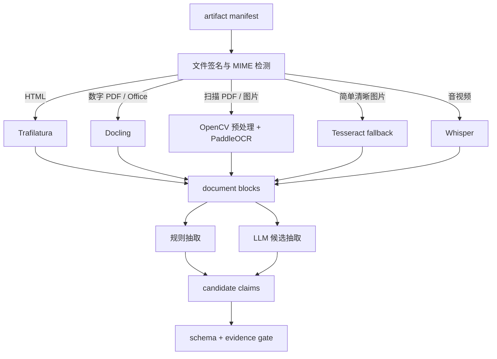

# M02：网页、文档、OCR 与多模态解析

状态：Accepted for PoC design  
主组件：Trafilatura、[Docling](https://github.com/docling-project/docling)、PaddleOCR、Tesseract（兜底）、Whisper（按需）、OpenCV  
上游：M01  
下游：M03、M05、M06、M08、M10

## 1. 职责与边界

M02 负责：

- 根据 MIME、文件签名和解析 profile 路由解析器；
- 将网页、PDF、Office、图片和音视频转换成有坐标的结构块；
- 抽取表格、段落、标题、图片、OCR token 和转录片段；
- 用规则或 LLM 生成带证据定位的 `candidate_claim`；
- 记录解析器、模型、prompt、schema 和依赖版本；
- 将失败文件隔离并支持使用新解析器重跑。

M02 不负责：

- 判断两个公司是否同一主体；
- 将候选声明直接升级为事实；
- 计算机会分数；
- 删除或修改 M01 原始文件。

## 2. 解析路由



### 路由原则

- 先使用确定性/低成本解析，再用模型补充；
- 同一 artifact 可以产生多个 extraction run，但每个 run 独立版本化；
- 不将 OCR 文本覆盖数字 PDF 原生文本；二者可并存并比较；
- 表格必须保留行列结构，不能只变成无结构段落；
- 网页变化优先解析 diff 区域，同时保留完整页面上下文。

## 3. Document Block 契约

```yaml
block_id: uuid
artifact_id: uuid
extraction_run_id: uuid
block_type: paragraph|heading|table|table_cell|image|ocr_token|transcript
page_number: 4
parent_block_id: uuid-or-null
reading_order: 27
bbox:
  x0: 0.12
  y0: 0.32
  x1: 0.88
  y1: 0.47
coordinate_system: normalized_top_left
start_ms: null
end_ms: null
text: "..."
language: en
confidence: 0.97
parser: docling
parser_version: x.y.z
model_id: null
content_hash: sha256:...
```

坐标统一为页面归一化左上角坐标；音视频使用毫秒区间。没有定位能力的抽取必须标记 `locator_quality=coarse`。

## 4. Candidate Claim 契约

```yaml
claim_id: uuid
subject_mention: "Example Manufacturing Ltd."
predicate: certification.valid_until
object_value: "2027-05-31"
object_type: date
artifact_id: uuid
evidence_block_ids: [uuid]
extractor_type: rule|llm|human
extractor_version: 1.2.0
prompt_version: regulatory-v3
schema_version: claim/1.0.0
confidence: 0.86
status: proposed
created_at: 2026-08-24T10:45:00Z
```

状态机：

```text
proposed → validated_rule → accepted
         ↘ needs_review → accepted/rejected
         ↘ rejected_schema
         ↘ superseded
```

## 5. 规则与 LLM 的分工

规则优先处理：

- 日期、金额、百分比、HS code、国家代码；
- 文档编号、通知编号、表格字段；
- 已知枚举和固定格式；
- 页面 diff 中的明确新增/删除。

LLM 适合处理：

- 受影响商品和措施类型候选；
- 条款摘要和事件角色；
- 多段落之间的关系；
- 非标准目录中的产品属性。

LLM 输出必须经过 JSON Schema 校验；自由文本解释不能直接进入结构化事实表。

## 6. Golden Dataset

为每种解析 profile 建立固定基准集：

- born-digital PDF；
- 扫描 PDF；
- 中英文混排证书；
- 跨页表格；
- 多栏法规；
- 动态网页下载；
- 商品目录图片和规格表；
- 一段带多语言口音的音视频（启用 Whisper 后）。

Golden 标注至少包含：文本、块顺序、表格结构、关键字段和证据坐标。

## 7. 失败与回退

| 情况 | 行为 |
|---|---|
| 文件损坏/加密 | 标记 unreadable；不生成空成功结果 |
| Docling 无表格结构 | 保留输出并尝试 OCR/table fallback；记录 fallback |
| OCR 语言未知 | 运行语言检测；置信不足进入人工选择 |
| LLM 无法满足 schema | 有限次数结构修复；仍失败则 rejected_schema |
| 模型服务不可用 | 规则和确定性解析仍发布；LLM 增强标记缺失 |
| 新解析器版本 | 新建 extraction run；旧结果保持可查询 |
| 文档含恶意指令 | 文本作为不可信数据；不能改变系统 prompt、工具权限或执行外部动作 |

## 8. 指标

- 每 profile 解析成功率；
- 每页/每 MB 延迟和成本；
- OCR CER/WER；
- 表格结构准确率；
- evidence locator 覆盖率；
- candidate claim schema 通过率；
- 人工接受/拒绝率；
- 不同模型/版本的差异率；
- quarantine 数量和原因。

## 9. M02 独立验收标准

| ID | 优先级 | 场景 | 通过条件 | 验收证据 |
|---|---|---|---|---|
| M02-AC-001 | P0 | 格式路由 | Golden 集中的 HTML、数字 PDF、扫描件和图片均进入正确解析器，无扩展名依赖错误 | 路由测试报告 |
| M02-AC-002 | P0 | 证据定位 | 100% accepted candidate claim 至少关联一个有效 block；block 能定位到存在的 artifact 页/区域/时间段 | 引用完整性查询 |
| M02-AC-003 | P0 | Schema gate | 对畸形 LLM 输出和类型错误进行注入；0 条非法 claim 进入 accepted 状态 | schema 测试 |
| M02-AC-004 | P0 | 原文保留 | 解析和重解析前后 raw hash 不变；新旧 extraction run 均可查询 | hash 与版本报告 |
| M02-AC-005 | P0 | 数字 PDF 质量 | Golden 数字 PDF 的关键字段字符准确率 ≥99%，关键表格单元格准确率 ≥95% | 标注对比报告 |
| M02-AC-006 | P0 | 扫描件质量 | Golden 清晰扫描件的关键字段字符错误率 ≤5%；低于阈值的页面被标为低置信而非静默通过 | OCR 评估报告 |
| M02-AC-007 | P0 | 阅读顺序 | 多栏和跨页 Golden 文档的关键段落顺序全部满足标注的先后约束 | 顺序测试 |
| M02-AC-008 | P0 | 不可信内容 | 文档中的 prompt injection 不能改变 schema、访问 secret、调用外部工具或自动接受 claim | 安全测试日志 |
| M02-AC-009 | P0 | 模型不可用降级 | 关闭 LLM 服务后，确定性解析正常完成，运行状态为 partially_enriched 而非 failed | 故障演练 |
| M02-AC-010 | P1 | 网页 diff | 只改变页面一段文本时，diff claim 指向变化块并保留前后 artifact | diff 验收样例 |
| M02-AC-011 | P1 | 成本预算 | 每类文档记录页数、CPU/GPU 时间和外部模型费用；超预算批次被暂停或降级 | 成本报告 |
| M02-AC-012 | P0 | 人工复核闭环 | reviewer 接受/拒绝后状态、理由、人员和时间均不可缺失，原 proposed 内容不被覆盖 | 审计查询 |

