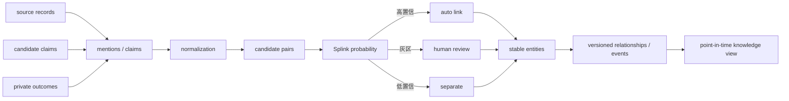

# M03：声明、实体解析、关系与知识层

状态：Accepted for PoC design  
主组件：[FollowTheMoney](https://github.com/opensanctions/followthemoney) 思想与 schema 扩展、Splink、OpenRefine/Streamlit 审核、NetworkX；PostGIS/H3 后置  
上游：M01、M02、M09  
下游：M05、M07、M08、M10

## 1. 职责与边界

M03 负责：

- 将来源记录和候选声明转换为规范化 claim；
- 管理公司、人员、设施、商品、地点、文件、事件和交易流实体；
- 识别同一主体的不同名称和记录；
- 保存关系、置信度、来源、时间有效性和审核决定；
- 产生可回溯的 point-in-time knowledge view；
- 为特征层提供稳定实体 ID。

M03 不负责：

- 删除重复来源记录；
- 把概率匹配伪装成确定事实；
- 计算最终机会分数；
- 代替专业制裁或法律合规结论。

## 2. 知识模型



## 3. 实体类型

| 类型 | 关键属性 | 特殊规则 |
|---|---|---|
| Organization | 名称、注册号、域名、国家、地址 | 出口商、工厂、品牌、买家不能仅凭名称角色互换 |
| Person | 姓名、职位、联系方式、关联公司 | PII 访问和保留受 M10 控制 |
| Facility | 名称、地址、坐标、设施类型 | 与 Organization 分离，一个公司可运营多个设施 |
| ProductClass | HS 版本、代码、层级、描述 | 不同 HS 版本是不同分类实体，以 concordance 连接 |
| Product | SKU、品牌、规格、用途 | 一个 Product 可映射多个候选 HS，保留不确定性 |
| Place | 国家、地区、城市、港口、H3 | 代码体系和有效期版本化 |
| Document | artifact 引用、文档类型、发布者 | 不复制 raw 内容，仅引用 M01 artifact |
| Event | 类型、参与者、地点、商品、时间、严重度 | 事件与文档分离，同一事件可有多来源 |
| TradeFlow | reporter、partner、flow、HS、period | 主要事实存在 M04；知识层保存关联语义 |
| Experiment | 研究、询盘、样品和订单试验 | 由 M09 主存，M03 连接实体与事件 |

## 4. Claim 模型

Claim 是“某来源在某时间对某对象提出了什么说法”，不是最终真相。

```yaml
claim_id: uuid
subject_ref: source-record-or-entity
predicate: organization.address
object_value: "123 Example Road"
object_ref: null
source_id: supplier_website
artifact_id: uuid
evidence_block_ids: [uuid]
published_at: 2026-08-01T00:00:00Z
observed_at: 2026-08-24T00:00:00Z
valid_from: null
valid_to: null
confidence: 0.91
status: accepted
decision_basis: human|rule|model
schema_version: claim/1.0.0
```

同一 predicate 允许存在冲突 claim。当前视图通过来源优先级、时间、置信度和审核状态生成，不能物理覆盖冲突。

## 5. 实体解析

### 标准化

- Unicode 和大小写标准化；
- 公司后缀词典按国家/语言处理；
- 域名、邮箱域、电话使用规范格式；
- 地址拆分并保留原文；
- 国家、语言和 transliteration 单独记录；
- 不删除具有区分度的数字和地名；
- 不用 LLM 直接生成 `same_as` 最终决定。

### 候选阻塞

阻塞键按实体类型配置：

- 注册号精确；
- 域名精确或历史域名；
- 国家 + 名称 token；
- 邮编/H3 + 名称相似；
- 电话或邮箱；
- 来源特定 ID 映射。

### 决策区间

- `p >= auto_link_threshold`：允许自动链接；
- `review_lower <= p < auto_link_threshold`：人工队列；
- `p < review_lower`：保持分离；
- 阈值由标注集校准，并按实体类型分别设置；
- 自动链接的目标是极高 precision，宁可降低 recall。

## 6. 关系与事件

所有关系都具有：

- `subject_entity_id`、`relationship_type`、`object_entity_id`；
- `valid_from/valid_to`；
- `system_from/system_to`；
- `source_claim_ids`；
- `confidence` 和 `review_status`。

图分析初期直接使用 NetworkX 从版本化关系表构建快照。只有出现持续图查询或空间查询需求后，才评估 Apache AGE/PostGIS/H3。

## 7. 合并、拆分与撤销

- 来源记录永远不删除；
- entity link 是独立的版本化决策；
- 发现误合并时关闭旧 link，建立新决策；
- 拆分后重新计算受影响的关系、特征和信号；
- M06 根据 lineage 找出需要重物化的下游资产；
- 历史报告仍引用当时使用的 entity resolution version。

## 8. 指标

- 标注集 precision、recall、F1；
- 自动链接数量、人工灰区数量、拒绝率；
- 误合并和撤销次数；
- entity 孤立率和别名覆盖；
- 冲突 claim 数量；
- 关系证据覆盖率；
- 实体版本变化影响的下游资产数；
- 人工审核平均时间。

## 9. M03 独立验收标准

| ID | 优先级 | 场景 | 通过条件 | 验收证据 |
|---|---|---|---|---|
| M03-AC-001 | P0 | 稳定实体 ID | 同一输入数据重跑后 entity_id 和 link 决策保持稳定 | 快照 diff |
| M03-AC-002 | P0 | 来源记录保留 | 合并两个来源记录后两条原记录、原名称和来源仍可独立查询 | 查询结果 |
| M03-AC-003 | P0 | 自动链接精度 | 在冻结标注集上 auto-link precision ≥99%；不足则必须提高阈值或禁用自动链接 | 评估报告 |
| M03-AC-004 | P0 | 灰区审核 | 中间概率候选不会自动合并；必须进入审核队列并保存决定理由 | 状态机测试 |
| M03-AC-005 | P0 | 可撤销 | 撤销一个错误链接后，实体、关系和受影响下游均重新生成；历史版本仍可查询 | 撤销演练 |
| M03-AC-006 | P0 | 冲突声明 | 两个来源给出不同地址/所有权时，两条 claim 均保留，当前视图显示选择依据 | 冲突 fixture 报告 |
| M03-AC-007 | P0 | 时间有效性 | 在关系开始前、有效期间和结束后三个 as-of 查询返回正确结果 | point-in-time 测试 |
| M03-AC-008 | P0 | 证据覆盖 | 100% accepted relationship 至少关联一个 claim；非人工自有信息 claim 必须关联 artifact/block | 完整性查询 |
| M03-AC-009 | P0 | HS 版本隔离 | 相同数字代码在不同 HS 版本中不被误认为同一 ProductClass；只通过 concordance 连接 | 分类测试 |
| M03-AC-010 | P1 | 多语言名称 | Golden 公司名集合中，中英/当地语言别名进入候选且不把同名不同国公司自动合并 | 标注评估 |
| M03-AC-011 | P1 | 图快照复现 | 给定 entity/link/relationship 版本，NetworkX 图节点、边和指标 hash 可复现 | 图快照报告 |
| M03-AC-012 | P0 | PII 约束 | 无相应权限的查询无法读取个人邮箱/电话，统计聚合仍可使用允许字段 | 权限测试 |

