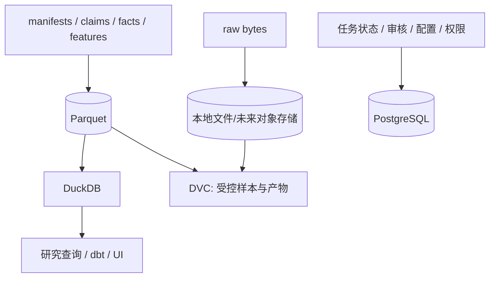

# M04：存储、查询与 Point-in-time 数据

状态：Accepted for PoC design  
主组件：Apache Arrow/Parquet、Polars、DuckDB、PostgreSQL、DVC；lakeFS 后置  
上游：M01、M02、M03、M09  
下游：M05、M06、M07、M08、M10

## 1. 职责与边界

M04 负责：

- 定义 raw/bronze/silver/gold 的物理边界；
- 提供 append-only 原始存储和列式分析数据；
- 提供操作状态的事务数据库；
- 实现 bitemporal/point-in-time 查询；
- 管理分区、压缩、原子发布、快照和恢复；
- 提供稳定查询接口而不暴露临时文件。

M04 不负责：

- 决定数据业务含义；
- 生成实体匹配；
- 调度何时运行；
- 定义机会评分。

## 2. 存储分工



### 物理职责

| 介质 | 保存内容 | 禁止内容 |
|---|---|---|
| 文件证据库 | 原始响应、网页、PDF、图片、音视频、截图 | 可变操作状态 |
| Parquet | manifests、blocks、claims、observations、features、signals、backtests | 高频小事务和多人编辑 |
| DuckDB | 对 Parquet 的查询、临时研究视图、物化快照 | 作为多人共享写服务 |
| PostgreSQL | source registry、run 状态、review、实验、权限、最新任务状态 | 全量历史 raw bytes 和超大面板事实 |
| DVC | Golden set、标注集、固定研究快照、模型产物 | 每日无限增长的全量 raw 数据 |

## 3. 数据区域

| 区域 | 允许内容 | 发布规则 |
|---|---|---|
| raw | 来源原始 bytes 和获取清单 | 一经写入不可覆盖 |
| bronze | 解析块、OCR token、结构表格、原始规范化行 | 可按解析器版本重建 |
| silver | claims、entities、relationships、point-in-time observations | 通过 schema 和完整性 gate |
| gold | features、signals、opportunities、backtests、reports | 上游完整、质量通过、版本冻结后原子发布 |

禁止下游直接依赖临时/工作目录。

## 4. 分区和文件策略

- raw 按 `source_id/retrieved_date` 分区；
- trade observations 按 `classification_version/period/reporter` 或实际查询模式设计；
- claims/events 按 `observed_date/source_id` 分区；
- features/signals 按 `feature_set_version/as_of_date` 分区；
- 控制小文件数量，批量 compact；
- 文件写入使用临时路径，校验后原子提交到 snapshot；
- 每个发布快照生成 manifest：文件列表、行数、min/max、schema hash 和内容 hash。

## 5. 时间模型

事实同时保存业务有效时间和系统版本时间：

```text
valid_from <= event/business time < valid_to
system_from <= knowledge time < system_to
```

历史研究 as-of `T` 只能看到 `system_from <= T < system_to` 的版本，同时要求 `observed_at <= T`。

### 示例

| period | value | observed_at | system_from | system_to |
|---|---:|---|---|---|
| 2026-05 | 100 | 2026-08-01 | 2026-08-01 | 2026-10-05 |
| 2026-05 | 108 | 2026-10-05 | 2026-10-05 | null |

`as_of=2026-08-24` 必须返回 100；`as_of=2026-10-10` 返回 108。

## 6. 原子发布

Gold snapshot 过程：

```text
build in staging
→ validate contracts and counts
→ calculate snapshot manifest/hash
→ commit metadata transaction
→ move/point published alias atomically
→ emit asset.published
```

UI 只读取已发布 snapshot ID，不能在物化中途看到半成品。

## 7. 备份与恢复

- PostgreSQL 每日逻辑/物理备份并进行恢复演练；
- raw 和 Parquet 使用第二位置备份或对象存储版本；
- manifest 是恢复索引，不依赖目录猜测；
- DVC remote 与 Git remote 分开；
- 恢复后重新计算 sample hashes 验证一致；
- 定义 RPO/RTO：PoC 默认 RPO 24 小时、RTO 4 小时，后续通过 ADR 调整。

## 8. 性能基线环境

PoC 性能验收统一使用已记录的基准环境，例如：

- 8 vCPU；
- 32 GB RAM；
- 本地 NVMe/SSD；
- 代表性 5,000 万行月度/双边观测测试集；
- 冷缓存与热缓存分别记录。

阈值不是跨硬件绝对承诺，但每次发布必须与同一基准比较，防止无意退化。

## 9. 指标

- 各区域字节和文件数；
- 小文件比例、压缩比；
- query p50/p95；
- snapshot 发布延迟；
- 备份成功、恢复时长；
- schema 版本数和兼容性；
- orphan artifact/file 数；
- point-in-time 查询扫描量。

## 10. M04 独立验收标准

| ID | 优先级 | 场景 | 通过条件 | 验收证据 |
|---|---|---|---|---|
| M04-AC-001 | P0 | 双 vintage 查询 | 使用两次修订 fixture，8 月和 10 月 as-of 查询分别返回对应版本，无未来泄漏 | SQL 测试结果 |
| M04-AC-002 | P0 | 原子发布 | 在发布中途杀死进程；消费者只能看到旧完整 snapshot，恢复后看到新完整 snapshot | 故障演练日志 |
| M04-AC-003 | P0 | 快照复现 | 固定 raw、代码、配置重建后，所有 gold manifest 行数、schema hash 和内容 hash 一致 | replay 报告 |
| M04-AC-004 | P0 | 区域隔离 | gold 模型不能直接依赖 work/tmp；CI 静态检查发现即失败 | dependency scan |
| M04-AC-005 | P0 | PostgreSQL/DuckDB 边界 | 大历史事实不写入操作表；review/任务状态不以 Parquet 作为事务主存 | 架构测试/表清单 |
| M04-AC-006 | P0 | 损坏检测 | 修改一个 raw/Parquet 文件字节后，完整性检查能定位并阻止使用 | hash 验证日志 |
| M04-AC-007 | P0 | 备份恢复 | 从备份在 RTO 4 小时内恢复 PostgreSQL 和选定 snapshot，抽样 hash 全部一致 | 恢复演练报告 |
| M04-AC-008 | P1 | 查询基线 | 在基准硬件上，代表性 5,000 万行聚合查询热缓存 p95 ≤10 秒；冷缓存结果单独记录 | benchmark 报告 |
| M04-AC-009 | P1 | 小文件控制 | 发布分区中低于设定最小目标大小的小文件比例不超过 10%，例外有记录 | storage report |
| M04-AC-010 | P0 | 单位与金额 | 100% 金额记录保留原币；发生换算时汇率来源、日期和版本非空 | 完整性查询 |
| M04-AC-011 | P0 | UTC 规则 | 所有系统时间字段有时区且规范为 UTC；来源本地时间未被丢弃 | schema/fixture 测试 |
| M04-AC-012 | P1 | 并发读取 | UI 查询与新 snapshot 构建并发时，无锁死、半成品或结果混合 | 并发测试 |

