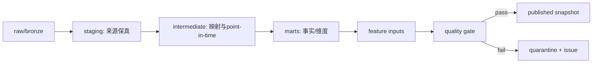

# M05：数据转换、契约与质量发布

状态：Accepted for PoC design  
主组件：dbt Core、dbt-duckdb、Pandera、Frictionless；Great Expectations 后置  
上游：M01–M04、M09  
下游：M06–M08、M10

## 1. 职责与边界

M05 负责：

- 将 raw/bronze/silver 转换为稳定事实、维度、特征输入；
- 管理 schema、单位、枚举、主键和业务质量契约；
- 实现 HS/country/entity 等一致维度和 concordance；
- 计算质量状态、隔离失败记录并控制发布；
- 输出带 lineage 的 silver/gold snapshot。

M05 不负责：

- 获取外部数据；
- 解析 PDF/OCR；
- 训练预测模型；
- 通过删除异常来“美化”数据。

## 2. 转换层



### dbt 目录

```text
dbt/models/
  staging/
  intermediate/
  marts/
  features/
  quality/
dbt/macros/
  point_in_time/
  currency/
  hs_concordance/
dbt/tests/
dbt/seeds/
  controlled_vocabularies/
```

## 3. 分层规则

### Staging

- 一张来源表对应一个 staging 模型；
- 只做重命名、类型解析、最小清洗；
- 保留来源字段和原始值；
- 添加 source/retrieval/artifact/vintage 标识；
- 不跨来源合并。

### Intermediate

- 国家、单位、币种、HS 版本映射；
- point-in-time 版本选择；
- 实体解析结果连接；
- 事件到商品/国家的候选映射；
- 复杂业务计算拆成可测试步骤。

### Marts

- `fct_trade_observation_pit`；
- `fct_entity_event`；
- `fct_private_outcome`；
- `dim_country`、`dim_product_hs`、`dim_entity`、`dim_source`；
- `bridge_hs_concordance`、`bridge_entity_resolution`。

### Feature inputs

- 输出粒度和时间切点固定；
- 不含未来信息；
- 缺失、异常、修订和置信字段显式存在；
- 特征算法由 M07 管理，M05 提供稳定输入和可共享 SQL 特征。

## 4. 数据契约层次

| 层 | 工具 | 用途 |
|---|---|---|
| 连接器 Python 对象 | Pandera/JSON Schema | 类型、必填、范围、枚举 |
| 文件批次 | Frictionless | 数据包资源、schema、hash、许可 metadata |
| SQL 模型 | dbt tests | 主键、关系、非空、接受值、业务断言 |
| 跨批次统计 | dbt + 自定义监控 | 行数、缺失率、分布、修订率和漂移 |
| 大规模/团队化后 | Great Expectations | 跨系统检查点和质量报告，可选 |

## 5. 质量状态

```text
received → contract_valid → business_valid → publishable → published
        ↘ rejected_schema
                         ↘ quarantined_quality
                                      ↘ approved_exception
```

`approved_exception` 必须有负责人、理由、有效期和影响范围，不能永久掩盖质量失败。

## 6. HS 与分类版本

- `classification_system`、`version`、`level` 是 ProductClass 主键的一部分；
- HS2017 代码不能直接与 HS2022 同码拼接；
- concordance 支持一对一、一对多、多对一，并保存权重来源；
- 历史回测使用当时的分类版本或明确的映射版本；
- 无可靠 concordance 的记录标记 unresolved，不进行静默最近邻映射。

## 7. 单位、数量和价格代理

- 保存来源 quantity、net weight、supplementary quantity 和单位；
- unit value 明确命名为代理，不称为成交价；
- 分母为零或单位不兼容时返回 missing reason；
- 极端值保留原值并增加 anomaly flag，不默认 winsorize；
- 任何去极值、填补和标准化都属于有版本的研究转换。

## 8. 数据质量问题模型

```yaml
issue_id: uuid
asset_key: fct_trade_observation_pit
snapshot_id: uuid
rule_id: TRADE-QUANTITY-UNIT-001
severity: error|warning|info
record_locator: {...}
observed_value: {...}
expected: {...}
detected_at: ...
status: open|waived|fixed
owner: module-team
waiver_expires_at: null
```

## 9. 指标

- contract 通过率；
- 各 severity 的 issue 数；
- quarantine 行数和比例；
- 数据新鲜度、完整性、唯一性；
- HS/国家/实体 unresolved 比例；
- 修订率和分布漂移；
- exception/waiver 数量与到期；
- 每次 snapshot 的质量得分，但不得用总分掩盖 P0 error。

## 10. M05 独立验收标准

| ID | 优先级 | 场景 | 通过条件 | 验收证据 |
|---|---|---|---|---|
| M05-AC-001 | P0 | Schema 失败 | 注入缺列、错误类型和非法枚举；全部被拒绝或隔离，0 条进入 published gold | contract 报告 |
| M05-AC-002 | P0 | 主键与关系 | 所有 gold 主键唯一；外键 orphan 数为 0，明确允许的 unknown member 除外 | dbt test 结果 |
| M05-AC-003 | P0 | HS 版本 | 跨 HS 版本同码 fixture 不被直接合并；只有指定 concordance version 时才映射 | 分类测试 |
| M05-AC-004 | P0 | Point-in-time SQL | 未来 observed_at 记录无法进入历史 as-of feature input | 防泄漏测试 |
| M05-AC-005 | P0 | 异常保真 | 极端 unit value 原值仍可查询，并带 anomaly/missing reason；没有静默截断 | fixture 查询 |
| M05-AC-006 | P0 | 不完整批次 | 上游 completeness_status != complete 时，对应 gold snapshot 不发布 | 集成测试 |
| M05-AC-007 | P0 | 质量例外 | waiver 缺负责人、原因或到期时间时无法生效；到期后自动恢复阻断 | waiver 测试 |
| M05-AC-008 | P0 | Lineage | 每个 published gold 模型可列出输入 snapshot、dbt model version 和 code SHA | lineage 报告 |
| M05-AC-009 | P1 | 漂移检测 | 代表性列的分布/行数突变超过配置阈值时产生 issue，但不自动删除数据 | drift 报告 |
| M05-AC-010 | P0 | 金额换算 | 任一换算值均能还原为原币金额 × 对应汇率版本；舍入误差在定义范围内 | 重算测试 |
| M05-AC-011 | P1 | 文档生成 | dbt 文档包含模型粒度、字段含义、所有者和测试；缺一项 CI 告警 | docs 检查 |
| M05-AC-012 | P0 | 可重复性 | 相同输入 snapshot 和代码重建结果 hash 一致 | replay 报告 |

