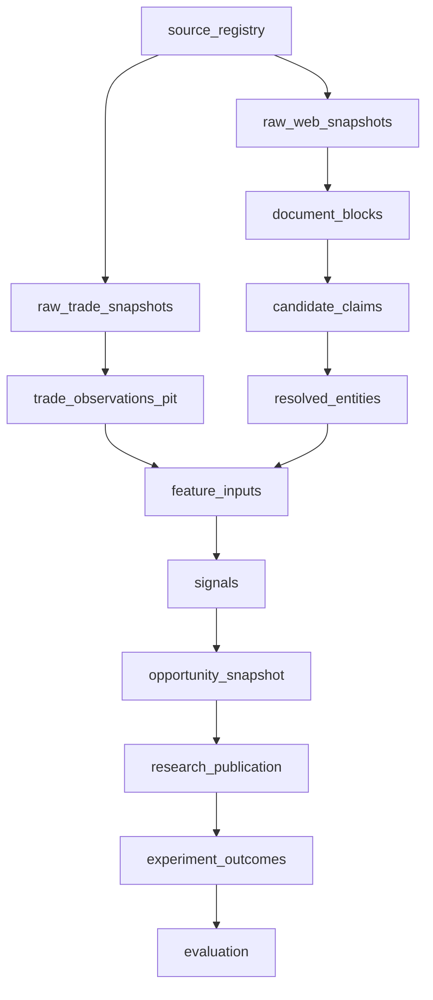

# M06：资产编排、重试、可观察性与恢复

状态：Accepted for PoC design  
主组件：[Dagster](https://github.com/dagster-io/dagster)；OpenLineage 语义兼容，正式目录后置  
上游：所有生产模块  
下游：所有消费模块、运维人员

## 1. 职责与边界

M06 负责：

- 将来源快照、解析结果、事实表、特征、信号和报告定义为数据资产；
- 管理 schedule、sensor、分区、重试、回填和依赖；
- 确保不完整上游不会触发正式下游发布；
- 保存 run、输入快照、代码、配置、输出和质量状态；
- 提供告警、恢复、重物化和影响分析。

M06 不负责：

- 在 asset 内隐藏业务转换逻辑；
- 成为 raw/事实数据主存；
- 通过重试绕过许可或质量 gate；
- 自动作出外部商业决策。

## 2. 资产组织



资产 key 应表达业务对象，不以脚本文件名命名。

## 3. 分区策略

| 资产 | 分区 |
|---|---|
| API/raw | source × retrieval date/period |
| trade observation | classification × reporter × period |
| document blocks | artifact/extraction profile |
| claims/entities | observed date 或 resolution version |
| features/signals | as-of date × feature/signal version |
| experiments | experiment ID × evaluation fold |

分区范围必须能支持精确回填，不应每次因一个来源变化重算全世界。

## 4. 触发机制

- schedule：已知发布节奏或周期性检查；
- sensor：新 artifact、网页变化、人工审核、私有 outcome；
- manual run：研究人员请求特定 universe/as-of；
- backfill：来源修订、代码修复、entity link 撤销；
- 禁止通过 UI 直接绕过 Dagster 写 gold。

## 5. Run Manifest

每次 materialization 必须保存：

```yaml
run_id: uuid
asset_key: feature_market_monthly
partition_key: 2026-08
started_at: ...
ended_at: ...
status: success
code_sha: ...
environment_lock_hash: ...
config_hash: ...
input_snapshot_ids: [...]
input_hashes: [...]
output_snapshot_id: uuid
output_hash: sha256:...
row_count: 123
quality_status: passed
retry_count: 0
```

## 6. 重试与副作用

- 纯计算 asset 可安全重试；
- 外部获取通过 M01 请求指纹和 retrieval 模型幂等；
- 外部业务动作由 M09 单独采用 idempotency key；
- 4xx 语义错误通常不重试，429/5xx/网络错误按策略重试；
- 重试上限、退避和 terminal 状态明确；
- 人工修复后从失败分区恢复，不要求全链重跑。

## 7. 告警等级

| 等级 | 示例 | 行为 |
|---|---|---|
| Critical | raw hash 损坏、未来数据泄漏、未授权外部动作 | 立即停止相关发布，人工处理 |
| Error | 完整批次失败、gold contract 失败 | 阻断下游，创建 issue |
| Warning | 数据延迟、分布漂移、OCR 质量下降 | 允许符合策略的降级发布并显著标注 |
| Info | 正常修订、新 artifact、计划回填 | 记录，不打扰人工 |

## 8. 可观察性

- 每 asset 成功率、延迟、运行时长；
- freshness 和 SLA；
- retry/terminal failure；
- 输入输出行数和 hash；
- 质量 gate 状态；
- 计算资源和外部 API 成本；
- backlog 和人工审核积压；
- 受修订或实体撤销影响的下游资产。

PoC 可以使用 Dagster UI 和结构化日志；Grafana/OpenLineage/DataHub 不是前置条件。

## 9. 恢复手册最低内容

每个关键 asset 必须文档化：

- 常见失败；
- 是否可自动重试；
- 安全重跑命令/操作；
- 如何确认输入完整；
- 如何回滚发布 alias；
- 如何重建 lineage；
- 何时必须升级人工审批。

## 10. M06 独立验收标准

| ID | 优先级 | 场景 | 通过条件 | 验收证据 |
|---|---|---|---|---|
| M06-AC-001 | P0 | 资产依赖 | 主链资产在 Dagster 中具有完整上游/下游关系，无孤立 gold 资产 | asset graph 导出 |
| M06-AC-002 | P0 | 上游阻断 | raw incomplete 或质量失败时，相关 gold 和 UI publication 不执行 | 集成测试日志 |
| M06-AC-003 | P0 | 瞬时失败重试 | 注入一次 5xx/网络失败后按策略恢复，最终无重复产物 | fault injection |
| M06-AC-004 | P0 | Terminal 失败 | 注入不可重试 schema 错误；任务停止并产生含上下文的 Error issue，不无限重试 | 运行日志 |
| M06-AC-005 | P0 | 分区回填 | 修订一个 reporter×period 分区，只重算受影响分区及其下游 | backfill 报告 |
| M06-AC-006 | P0 | Run manifest 完整 | 100% published materialization 含代码、环境、配置、输入快照、输出 hash 和质量状态 | 完整性查询 |
| M06-AC-007 | P0 | 断点恢复 | 在解析或特征中间杀死 worker，恢复后从安全 checkpoint 继续，无半发布 snapshot | 恢复演练 |
| M06-AC-008 | P0 | 告警路由 | Critical/Error/Warning fixture 分别产生符合策略的阻断和通知行为 | 告警测试 |
| M06-AC-009 | P1 | Freshness | 来源超过配置新鲜度 SLA 时榜单显示 stale 且告警；不能静默使用为“最新” | freshness 测试 |
| M06-AC-010 | P0 | 重物化影响 | 撤销实体链接后，系统准确列出并重算受影响特征/信号，其他分区不动 | lineage/backfill 证据 |
| M06-AC-011 | P1 | 成本观测 | 外部 API/LLM/OCR 任务均记录用量和估算成本，超预算策略生效 | 成本日志 |
| M06-AC-012 | P0 | 恢复手册 | 每个 P0 asset 都有可执行 runbook；随机抽取一个故障按手册在目标时间内恢复 | 演练报告 |

