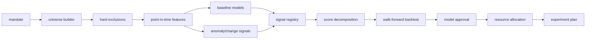

# M07：特征、信号、回测与资源配置

状态：Accepted for PoC design  
主组件：StatsForecast、PyOD、ruptures、skfolio；DoWhy/River 按需；借鉴 Qlib/LEAN/Zipline 的研究分层  
上游：M03–M06、M09  
下游：M08、M09、M10

## 1. 职责与边界

M07 负责：

- 定义配置化机会 universe 和硬性排除；
- 注册、计算和版本化特征；
- 建立透明基线、预测、异常和结构变点信号；
- 进行严格 point-in-time walk-forward 回测；
- 将机会排名转换为受约束的研究/执行资源配置；
- 评估信号稳定性、成本、集中度和真实业务结果。

M07 不负责：

- 证明相关性就是因果；
- 把异常自动解释成利好；
- 在没有授权时执行外部动作；
- 因回测表现差而删除不利样本；
- 将架构验收与“必须发现 Alpha”绑定。

## 2. 研究对象

```text
opportunity_id = ProductClass × ImportMarket × BuyerType
research_snapshot = opportunity_id × as_of × universe_version
```

PoC 宽扫描从配置化 HS4×市场开始，窄增强候选可下钻 HS6 和具体买家类型。

## 3. 研究流水线



## 4. Mandate 与 Universe

Mandate 至少定义：

```yaml
mandate_id: low-capital-b2b-v1
capital_budget: 100000 CNY
research_hours_budget: 200
sample_budget: 20000 CNY
inventory_allowed: false
max_trial_loss: 3000 CNY
target_turnover_days_max: 60
excluded_hs_chapters: [...]
excluded_regulatory_classes: [...]
country_risk_max: configured
minimum_market_value: configured
minimum_data_confidence: configured
max_country_exposure: 0.30
max_hs_chapter_exposure: 0.25
exploration_budget_share: 0.15
version: 1.0.0
```

Universe 构建必须记录进入/退出原因。历史回测不得使用未来赢家反向定义 universe。

## 5. Feature Registry

```yaml
feature_name: demand_acceleration_3m_vs_36m
feature_version: 1.0.0
entity_grain: opportunity
as_of_frequency: monthly
lookback: 36M
availability_lag_rule: source-specific
inputs: [fct_trade_observation_pit]
formula_ref: dbt://feature_market_monthly
unit: zscore
expected_direction: positive
missing_policy: explicit_missing_indicator
normalization_scope: cross_section_as_of
owner: research
status: approved
```

所有归一化仅使用当期横截面或训练窗口，禁止全样本归一化。

## 6. 第一代信号

| 信号 | 工具/方法 | 解释 |
|---|---|---|
| Demand acceleration | dbt/Polars + StatsForecast baseline residual | 当前增长是否超出季节/趋势基线 |
| Supplier disruption | 份额变化、HHI、ruptures | 供应结构是否发生变点 |
| China gap | 同类市场基准差 + 趋势 | 高需求但中国份额低是否具有结构解释 |
| Price dispersion | unit value 分布 + PyOD | 不同来源价格代理是否异常分化 |
| Regulatory change | 事件强度、距离生效时间、证据置信 | 法规是催化剂还是摩擦 |
| Data risk | 缺失、滞后、修订、冲突、解析置信 | 对所有 Alpha 进行折扣 |
| Execution friction | 认证、物流、MOQ、售后、供应可得性 | 来自规则、人工和私有反馈 |

## 7. 评分模型

第一版使用透明分解：

```text
raw_alpha = Σ(direction_i × weight_i × normalized_feature_i)
risk_penalty = regulatory + volatility + concentration + execution
confidence = source_coverage × freshness × extraction_quality × entity_quality
final_score = (raw_alpha - risk_penalty) × confidence
```

要求：

- 每项贡献可见；
- 权重和方向版本化；
- missing 不自动当 0，除非特征定义明确；
- 低 confidence 不能靠极端 raw alpha 获得无限高排名；
- 规则排除优先于分数。

## 8. 预测与验证

### 标签

公开代理标签：

- 未来 3/6/12 月进口价值/数量增长；
- 供应份额变化；
- unit value 方向和稳定性；
- 负面政策/供应事件。

私有业务标签：

- 回复、有效 RFQ、报价接受、样品、试单、复购；
- 毛利、销售耗时、样品成本、回款天数、质量损失；
- 供应商报价稳定性和履约可靠度。

### Walk-forward

```text
train [过去] → validation [随后] → test [更后]
滚动前进，任何预处理只在 train 拟合
```

禁止随机打乱时间；允许按国家/商品设计额外的 group holdout 检验泛化。

## 9. 评价指标

### 预测/排序

- rank IC / Spearman；
- Top-K precision、lift 和稳定性；
- 分位数组合未来结果；
- calibration 和预测区间覆盖；
- 不同国家、HS 章节和时间 regime 的表现。

### 经济与执行

- 研究成本后的 expected value；
- 样品/触达/库存的资金占用；
- 转化漏斗和时间；
- 集中度和尾部损失；
- 相对简单基线的增量价值。

### 数据风险

- 修订敏感性；
- 缺失和来源滞后敏感性；
- 实体解析错误敏感性；
- 权重/阈值稳定性；
- 多重检验和参数搜索数量。

## 10. 资源配置

skfolio/Riskfolio 思想只用于分配有限资源，不把机会当可即时交易证券。

决策变量：

- 研究小时；
- 供应商询价数；
- 买家触达数；
- 样品预算；
- 试单最大风险额度。

约束：

- 国家、HS 章节、买家和供应商集中度；
- 数据置信下限；
- 单机会最大损失；
- 探索预算和利用预算分开；
- 高相关机会去重或降低同时配置。

## 11. 模型注册与批准

模型/策略状态：

```text
draft → backtested → reviewed → paper_approved → limited_live → scaled
      ↘ rejected
      ↘ retired
```

进入 limited_live 必须有：冻结报告、适用范围、失效条件、最大预算、owner 和 rollback。

## 12. M07 独立验收标准

| ID | 优先级 | 场景 | 通过条件 | 验收证据 |
|---|---|---|---|---|
| M07-AC-001 | P0 | 配置化 universe | 更换 mandate/universe 配置即可改变扫描范围；业务代码中无硬编码产品白名单 | 配置与静态扫描 |
| M07-AC-002 | P0 | Universe 可追溯 | 任一机会能说明进入/排除原因和当时 universe version | 查询报告 |
| M07-AC-003 | P0 | 防未来泄漏 | 注入一个未来才 observed 的高预测特征，历史回测无法读取；测试必须失败于故意泄漏实现 | leakage sentinel 测试 |
| M07-AC-004 | P0 | Walk-forward | 所有 fold 满足 train < validation < test；预处理器仅在 train 拟合 | fold manifest |
| M07-AC-005 | P0 | 分数可分解 | 100% opportunity 的 final_score 可由保存的分项、权重、风险和置信重新计算，误差在数值容差内 | 重算报告 |
| M07-AC-006 | P0 | Missing 语义 | 缺失数据不会被无记录地填 0；每个 missing 有策略和 indicator | 特征审计 |
| M07-AC-007 | P0 | 基线比较 | 任一复杂模型必须与季节朴素、简单趋势/统计基线比较；无法提升时允许被拒绝 | 模型报告 |
| M07-AC-008 | P0 | 可重复回测 | 固定 snapshot、代码、环境和 seed 后，核心指标与机会排序 hash 一致 | replay 报告 |
| M07-AC-009 | P0 | 成本与约束 | 回测和配置同时计入研究/执行成本；违反国家/商品/损失上限的配置无法发布 | 约束测试 |
| M07-AC-010 | P0 | 无 Alpha 也可通过 | 构造无信号数据；平台正确报告无增量价值，而不是选择性删除样本或参数 | null simulation 报告 |
| M07-AC-011 | P1 | 修订敏感性 | 使用 first-vintage 与 latest-vintage 分别评估并报告差异 | sensitivity report |
| M07-AC-012 | P1 | 多重搜索透明 | 保存尝试过的特征、模型、参数和实验总数；报告选择偏差风险 | experiment registry |
| M07-AC-013 | P0 | Live gate | 未达到 paper_approved 或无预算/owner/失效条件的策略无法生成 M09 外部实验计划 | 状态机测试 |
| M07-AC-014 | P1 | 置信折扣 | 相同 raw alpha 下，低数据置信机会的 final_score 必须不高于高置信机会 | 单元测试 |

