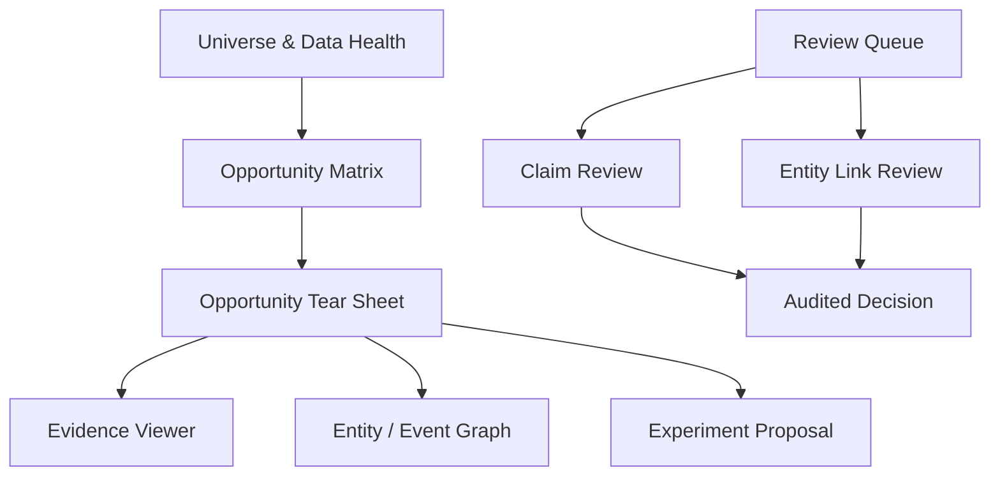

# M08：研究终端、证据下钻与人工复核

状态：Accepted for PoC design  
主组件：Streamlit、Perspective；Kepler.gl 按需  
上游：M03–M07、M09、M10  
下游：研究人员、审核人员、M03、M09

## 1. 职责与边界

M08 负责：

- 展示 universe、数据质量、机会矩阵和 tear sheet；
- 从分数下钻到特征、事实、claim、block 和 raw artifact；
- 提供实体匹配和候选声明的人工复核界面；
- 展示模型、snapshot、as-of 和数据置信；
- 收集人工决定、注释和研究任务申请。

M08 不负责：

- 在 UI 内重新实现特征公式；
- 直接修改 Parquet/gold；
- 允许用户绕过权限发送外部消息或下单；
- 隐藏缺失、过期或低置信数据。

## 2. 页面架构

## 3. 页面规范

### Universe & Data Health

必须显示：

- mandate/universe version；
- as-of；
- included/excluded 数量和原因；
- 来源 freshness、completeness、quality 和许可状态；
- 最近修订及受影响资产；
- 低置信或 stale 数据警示。

### Opportunity Matrix

主键：`opportunity_id + as_of + scoring_version`。

列组：

- 市场容量与需求；
- 供应结构；
- 价格代理；
- 政策和事件；
- 执行摩擦；
- 数据置信；
- raw alpha、risk penalty、final score；
- 排除/限制状态。

Perspective 用于排序、透视和聚合；UI 不自行计算最终分数。

### Opportunity Tear Sheet

必须包含：

- 历史和预测区间；
- 供应来源结构与变点；
- unit value 代理及注意事项；
- 政策/网页/企业事件时间线；
- 相关实体和关系；
- 分数分解；
- 数据覆盖、修订和置信；
- 适用范围、风险和失效条件；
- 创建研究/实验提案入口。

### Evidence Viewer

从 claim/feature/event 直接定位：

- source 和 URL；
- artifact hash、retrieved/published/observed 时间；
- 页面、bbox、段落、表格单元格或媒体时间段；
- 原文和解析版本；
- 许可/访问限制；
- 前后版本 diff（若有）。

### Review Queue

- reviewer 只能处理有权限的类型；
- 决定必须包含理由代码，可附文字说明；
- UI 使用乐观锁/版本检查防止覆盖他人决定；
- 已接受记录不能在 UI 中无审计修改；
- 修改产生新版本并触发 M06 下游重算。

## 4. 查询边界

- UI 只读取 published snapshot 和 PostgreSQL 操作表；
- 每个页面请求带显式 `snapshot_id/as_of`；
- 不允许一页混用不同 snapshot 而不显示；
- 大结果先由 DuckDB 聚合，浏览器接收有限行；
- raw artifact 访问通过受控读取层，执行许可和权限检查；
- 导出文件记录用户、筛选、snapshot 和时间。

## 5. 状态与防误导设计

清晰区分：

- fact / accepted claim / proposed claim；
- actual / forecast / scenario；
- observed event / inferred event；
- current snapshot / historical as-of；
- raw score / confidence-adjusted score；
- missing / zero / not applicable；
- stale / complete / partial。

颜色不能成为唯一编码；状态必须有文本标签。

## 6. 权限角色

| 角色 | 能力 |
|---|---|
| Viewer | 浏览允许的数据和证据 |
| Analyst | 创建研究视图、注释和实验提案 |
| Reviewer | 接受/拒绝指定 claim/entity link |
| Operator | 重跑允许资产、处理数据问题 |
| Approver | 批准 M09 有限外部实验和预算 |
| Admin | 管理用户、来源和策略，不默认拥有业务审批权 |

## 7. 性能与可用性

PoC 基准：

- 5 万行机会矩阵的数据准备和首屏 p95 ≤3 秒（基准硬件、热缓存）；
- tear sheet 常规查询 p95 ≤2 秒；
- Evidence Viewer 定位数字 PDF 页/块 p95 ≤2 秒，不含首次大文件下载；
- 长任务异步运行并显示 run ID，不阻塞浏览器请求；
- 支持键盘操作和基本可访问标签。

## 8. M08 独立验收标准

| ID | 优先级 | 场景 | 通过条件 | 验收证据 |
|---|---|---|---|---|
| M08-AC-001 | P0 | Snapshot 一致 | 任一页面显示非空 snapshot_id/as_of；同一页面所有查询使用同一 snapshot | UI 集成测试 |
| M08-AC-002 | P0 | 完整下钻 | 从任一 Top-K 机会可到分数分项、特征、事实/claim 和原始 artifact 定位；断链率为 0 | 自动遍历报告 |
| M08-AC-003 | P0 | 状态不混淆 | proposed claim、forecast、missing 和 stale 均有文本状态，不能显示为已确认当前事实 | 视觉/DOM 测试 |
| M08-AC-004 | P0 | UI 不重复计算 | 修改后端保存的分数组成后 UI 如实显示；代码扫描无独立评分公式副本 | 集成与静态检查 |
| M08-AC-005 | P0 | 审核审计 | 接受/拒绝必须记录 reviewer、时间、输入版本、理由和新状态；原记录不可覆盖 | 审计查询 |
| M08-AC-006 | P0 | 并发审核 | 两人同时处理同一任务时只有一个基于当前版本成功，另一人收到版本冲突 | 并发测试 |
| M08-AC-007 | P0 | 权限 | Viewer 无法审核或创建外部实验；Reviewer 无法提升预算；Approver 操作完整记录 | RBAC 测试 |
| M08-AC-008 | P0 | 受限证据 | 无权限用户无法读取受限 raw 内容或通过导出绕过；可见元数据按策略展示 | 安全测试 |
| M08-AC-009 | P1 | 性能 | 机会矩阵、tear sheet、evidence viewer 达到记录的 p95 预算 | 性能报告 |
| M08-AC-010 | P1 | 可访问性 | 核心流程可用键盘完成；表格、图表、状态和按钮具有可访问名称 | accessibility audit |
| M08-AC-011 | P0 | 导出审计 | 每次 CSV/报告导出保存用户、筛选、snapshot、行数和时间 | audit log |
| M08-AC-012 | P0 | 过期提示 | 数据超过 freshness SLA 后页面明显标记，并禁止被误称为“最新” | UI fixture 测试 |

