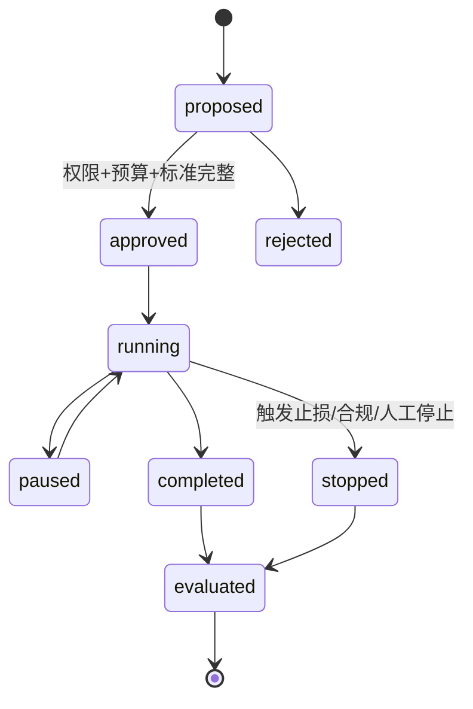

# M09：研究任务、询盘、样品、订单与真实反馈

状态：Accepted for PoC design  
主组件：PostgreSQL 状态机、受控任务/表单；外部 CRM/邮件连接器后置  
上游：M07、M08、M10  
下游：M03、M05–M08、M10

## 1. 职责与边界

M09 负责：

- 把机会排名转为有预算、有 owner、有期限的研究实验；
- 记录供应商研究、报价、买家触达、样品、试单、订单和回款；
- 保存成本、耗时、风险、质量问题和负面结果；
- 生成私有 outcome 标签反馈给知识和研究层；
- 对任何外部动作实行授权、额度、幂等和审计。

M09 不负责：

- 自动冒充人工进行谈判；
- 在 PoC 阶段自动付款、签署合同或承诺价格；
- 只保存成功案例而忽略失败和无响应；
- 用当前最终结果回写并改变历史机会快照。

## 2. 实验对象

```yaml
experiment_id: uuid
experiment_type: supplier_quote|buyer_outreach|sample|trial_order
opportunity_snapshot_id: uuid
mandate_version: 1.0.0
strategy_version: 1.0.0
owner: user-id
approver: user-id
budget:
  research_hours: 8
  outreach_count: 20
  cash_max: 3000 CNY
  max_loss: 1000 CNY
start_at: ...
end_at: ...
success_definition: "..."
stop_conditions: [...]
status: approved
```

## 3. 状态机



外部动作状态单独记录，不能靠实验状态推测邮件是否发送或样品是否寄出。

## 4. 业务事件模型

```text
candidate_selected
supplier_identified
supplier_contacted
supplier_quote_received
buyer_identified
outreach_prepared
outreach_approved
outreach_sent
reply_received
rfq_received
quote_sent
sample_requested
sample_sent
sample_accepted/rejected
trial_order_created
payment_received
production_started
inspection_completed
shipment_dispatched
delivery_confirmed
quality_issue_opened/resolved
repeat_order
```

每个事件包括：

- actor、occurred_at、recorded_at；
- experiment/opportunity/entity；
- idempotency_key；
- 金额、币种、数量和单位（如适用）；
- source artifact 或附件；
- previous event / causation；
- privacy class；
- event schema version。

## 5. 对外动作安全闸门


PoC 默认：

- 系统可以生成草稿和任务；
- 人工必须明确批准发送；
- 不允许自动付款、合同签署或订单承诺；
- 任何 connector 重试使用 idempotency key；
- 达到预算、数量、损失或合规阈值立即停止。

## 6. 成本与结果

### 成本

- 研究人员时间；
- 数据/API/模型费用；
- 供应商询价和采购样品；
- 买家触达和会议；
- 物流、检测、认证和差旅；
- 资金占用和汇率；
- 质量、退款和坏账损失。

### 结果

- 回复和有效 RFQ；
- 报价差、MOQ、交期和付款条件；
- 样品通过/失败及原因；
- 订单额、毛利、回款天数；
- 准时率、验货和质量问题；
- 复购及预计 LTV；
- 明确的“不值得继续”结论。

无回复也是结果，必须保存触达时间和观察窗口，不能删除。

## 7. 私有数据回流

- Supplier quote 形成带有效期的供应声明；
- 交期、MOQ、价格和质量形成供应商历史；
- Buyer reply/RFQ 形成需求意图事件；
- 样品、试单、回款形成真实 outcome；
- M03 负责链接实体，M05 构建事实，M07 评估模型；
- 回流数据按 `observed_at` 进入，不改写原机会快照。

## 8. 信用和风险

为买家、供应商和实验分别维护状态，不给出无法解释的“万能信用分”。

风险维度包括：

- 身份和主体一致；
- 报价稳定；
- 样品和批量一致；
- 交付和质量；
- 付款和账期；
- 合规文件；
- 历史争议和处置。

订单/额度升级必须由历史事件和政策约束驱动。

## 9. 指标

- 每阶段转化率和耗时；
- 每有效 RFQ/样品/订单成本；
- 预算使用、最大损失和停止次数；
- 报价离散、交期准确、质量问题；
- 回款天数和坏账；
- 私有标签缺失率；
- 成功/失败/无响应的完整记录率；
- 模型分数与真实结果校准。

## 10. M09 独立验收标准

| ID | 优先级 | 场景 | 通过条件 | 验收证据 |
|---|---|---|---|---|
| M09-AC-001 | P0 | 实验来源 | 每个 approved 实验都关联冻结 opportunity snapshot、mandate、strategy、owner 和期限 | 完整性查询 |
| M09-AC-002 | P0 | 预算 gate | 缺预算/最大损失/stop condition 的实验不能 approved；超额度动作被阻断 | 状态机测试 |
| M09-AC-003 | P0 | 人工发送 gate | 无人工批准时外部 connector 调用数为 0；批准后仅执行对应动作 | mock connector 日志 |
| M09-AC-004 | P0 | 外部幂等 | 对同一 action 重试三次，外部系统只产生一次发送/创建，内部保留三次 attempt | idempotency 测试 |
| M09-AC-005 | P0 | 负面结果保留 | 拒绝、失败、无响应和质量问题均可记录并进入 evaluation，不被成功筛选逻辑丢弃 | outcome 查询 |
| M09-AC-006 | P0 | 历史不可改写 | 新 outcome 到达后原 opportunity snapshot 和当时决策保持不变，只新增 evaluation/label | 前后 hash 报告 |
| M09-AC-007 | P0 | 金额与数量 | 100% 交易事件具有原币、币种、数量、单位和时间；换算遵守 INV-015 | 数据契约测试 |
| M09-AC-008 | P0 | 停止条件 | 注入预算超限、合规阻断和人工停止，实验进入 stopped 且不能继续外部动作 | 故障/策略测试 |
| M09-AC-009 | P0 | 附件证据 | 报价单、样品报告、验货和付款凭证作为 M01 artifact 管理并可追溯 | 证据链查询 |
| M09-AC-010 | P1 | 漏斗完整 | 所有状态转换符合允许图；越级事件被拒绝或显式记录为 corrected_import | 状态机测试 |
| M09-AC-011 | P1 | 无响应标签 | 到达配置观察窗口后自动生成 censored/no_response 状态，不把未成熟样本当失败 | 时间测试 |
| M09-AC-012 | P0 | 权限隔离 | Analyst 可提案但不能批准；Approver 不能修改原始结果；所有动作有 actor | RBAC 审计 |
| M09-AC-013 | P1 | 成本归因 | 一次实验的直接成本能够按事件重算，与保存汇总在容差内一致 | 重算报告 |
| M09-AC-014 | P0 | 删除/更正 | 业务记录不能硬删除；更正产生反向/替代事件并保留原值 | 审计测试 |

