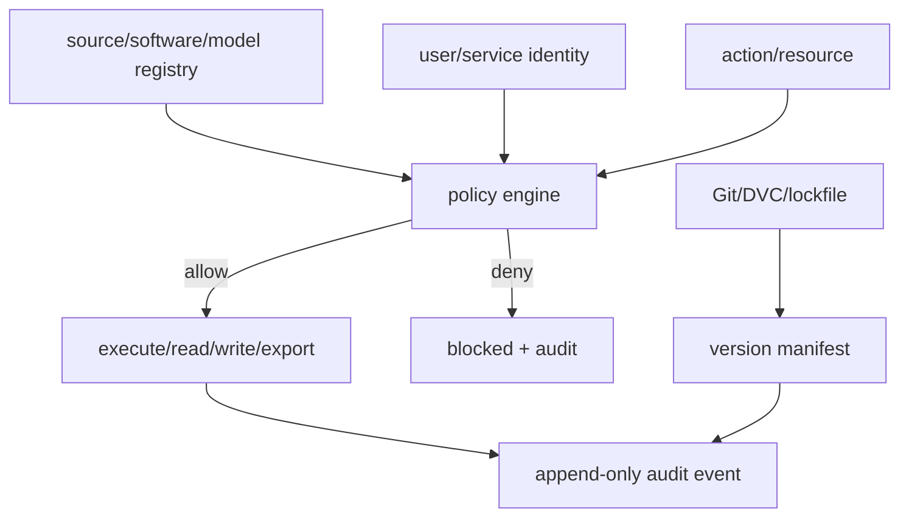

# M10：版本、许可、安全、审计与保留策略

状态：Accepted for PoC design  
主组件：Git、DVC、PostgreSQL RBAC、内容 hash、依赖/secret/license 扫描  
上游/下游：约束全部模块

## 1. 职责与边界

M10 负责：

- 软件、模型、数据、API 和内容使用权登记；
- 代码、环境、schema、配置、prompt、模型和数据版本治理；
- Secret、身份、角色和最小权限；
- 不可抵赖的审计事件和导出记录；
- PII/敏感数据分类、保留、删除与法律 hold；
- 供应链依赖、漏洞和许可证风险检查。

M10 不负责：

- 宣称系统自动完成法律判断；
- 用“公开可访问”代替许可确认；
- 允许管理员默认兼任业务审批人；
- 静默删除历史研究证据。

## 2. 治理平面



## 3. 许可登记

必须分别记录：

| 对象 | 字段 |
|---|---|
| 软件 | repo、version/commit、SPDX、修改、分发方式、NOTICE 要求 |
| 模型/权重 | model ID、权重许可、来源、使用限制、是否外部服务 |
| API | 条款 URL、账户类型、速率、缓存、再分发、商业用途 |
| 数据集 | owner、data license、attribution、商业/衍生/再分发、地域限制 |
| 网页内容 | domain policy、robots、条款、抓取目的、保存期限、法律复核 |

高风险示例：代码 MIT 但数据非商业、AGPL 网络分发义务、Commons Clause、模型代码与权重许可不同。

## 4. 数据分类

| 等级 | 示例 | 默认规则 |
|---|---|---|
| Public | 官方公开统计和允许再用的公告 | 可供内部广泛读取，仍保留署名 |
| Internal | 研究特征、策略、榜单 | 仅团队内部，导出审计 |
| Confidential | 供应商报价、客户沟通、合同、成本 | 最小权限、加密、限制导出 |
| Restricted | 个人联系方式、付款凭证、受限许可数据 | 明确授权、详细审计、短保留或法律要求 |

## 5. 身份与权限

- 人员使用唯一账户，禁止共享管理员账号；
- 服务账户按模块和环境隔离；
- raw 读取、审核、业务批准、系统管理分别授权；
- Admin 不默认拥有 Approver 权限；
- 权限变化本身写审计；
- PoC 可以简化身份提供方，但数据层必须执行权限，不能只隐藏 UI 按钮。

## 6. Secret 管理

- `.env`/本地 secret store 仅用于开发，文件不进 Git；
- 日志、错误、URL、manifest 对 token 脱敏；
- secret 有 owner、用途、创建、轮换和撤销时间；
- 生产环境优先使用操作系统/云 secret manager；
- Playwright 浏览器存储和 cookie 属于 Restricted；
- 测试使用假 secret 并运行 secret scanner。

## 7. 审计事件

高价值动作必须记录：

- 来源启停和许可状态变化；
- raw 访问和受限内容导出；
- claim 接受/拒绝；
- entity link 合并/撤销；
- 模型批准/退役；
- 实验批准、外部发送、预算变化；
- 用户/角色/权限变化；
- 数据更正、保留和删除。

审计事件至少包含 actor、action、resource、before/after hash、time、reason、correlation ID、客户端/服务身份。

## 8. 版本清单

每个 published snapshot/report 必须能够解析出：

```yaml
architecture_spec_version: 0.1.0
code_sha: ...
environment_lock_hash: ...
source_versions: {...}
schema_versions: {...}
parser_versions: {...}
prompt_versions: {...}
model_versions: {...}
entity_resolution_version: ...
feature_set_version: ...
signal_version: ...
mandate_version: ...
input_snapshot_ids: [...]
```

## 9. 保留与删除

- raw 的保留期由来源 policy 决定；
- Restricted PII 默认采用最短必要期限；
- 删除请求首先检查法律/合同 hold；
- 受许可要求必须删除时，生成 tombstone 和删除审计，不伪造原内容仍存在；
- 已删除内容的衍生数据必须评估是否也需删除/重建；
- 删除不等于 Git 历史或备份自动消失，需专门流程覆盖所有副本。

## 10. 依赖与供应链

- Python/JS/容器依赖锁版本；
- 记录直接和传递依赖许可；
- 运行已知漏洞扫描；
- 禁止未登记的网络服务/SDK；
- 升级解析器或模型必须跑 Golden 和回放测试；
- 高风险许可证依赖不能无 ADR 进入核心路径。

## 11. 威胁重点

- 抓取内容中的 prompt injection；
- 恶意/畸形 PDF 和压缩炸弹；
- SSRF、浏览器下载和重定向；
- 供应链包投毒；
- SQL/公式/CSV 注入；
- 受限数据通过导出或日志泄漏；
- 外部动作重试造成重复发送/下单；
- 管理员绕过业务审批；
- 历史证据或审计记录被篡改。

## 12. M10 独立验收标准

| ID | 优先级 | 场景 | 通过条件 | 验收证据 |
|---|---|---|---|---|
| M10-AC-001 | P0 | 来源许可完整 | 所有 enabled source 的 API、数据、商业使用、缓存/保留和再分发状态非空；否则被 M01 阻断 | registry 报告 |
| M10-AC-002 | P0 | 软件/数据分离 | OpenSanctions 类 fixture 中代码许可与数据许可分开显示，策略使用数据许可作商业 gate | policy 测试 |
| M10-AC-003 | P0 | Secret 扫描 | Git 历史候选、日志、manifest、错误栈和导出中无真实 secret | 扫描报告 |
| M10-AC-004 | P0 | 最小权限 | 对 Viewer/Analyst/Reviewer/Operator/Approver/Admin 运行权限矩阵，未授权操作全部拒绝 | RBAC 报告 |
| M10-AC-005 | P0 | 数据层权限 | 绕过 UI 直接查询/接口调用时，Restricted 数据仍被拒绝 | API/DB 测试 |
| M10-AC-006 | P0 | 审计完整 | 所有高价值动作均产生 actor、时间、before/after、理由和 correlation ID；缺失率 0 | 审计查询 |
| M10-AC-007 | P0 | 审计篡改 | 修改/删除历史审计记录的尝试被拒绝或可检测；校验链能定位异常 | 完整性演练 |
| M10-AC-008 | P0 | 版本清单 | 任一 published opportunity/report 可生成完整 version manifest，无 unknown 必填项 | manifest 检查 |
| M10-AC-009 | P0 | 恶意内容隔离 | prompt injection、压缩炸弹、恶意重定向和 CSV 公式 fixture 不造成工具调用、资源耗尽或导出执行 | 安全测试 |
| M10-AC-010 | P0 | 删除流程 | 对测试主体执行删除：活动存储、索引、缓存和规定备份流程均处理，并保留 tombstone/audit | 删除演练报告 |
| M10-AC-011 | P1 | 依赖许可 | 构建依赖 SBOM；高风险/未知许可证导致 CI 阻断，批准例外必须关联 ADR | SBOM/CI 报告 |
| M10-AC-012 | P1 | 漏洞扫描 | Critical 漏洞无过期豁免；构建阻断行为符合政策 | vulnerability report |
| M10-AC-013 | P0 | 权限分离 | Admin 在未额外授予 Approver 时无法批准 M09 实验；角色提升有独立审计 | segregation test |
| M10-AC-014 | P0 | 导出控制 | Restricted/Confidential 导出需要相应权限并记录范围；禁止通过日志或错误回显绕过 | exfiltration test |

