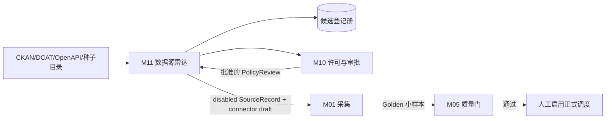

# M11 数据源雷达、评估与受控入驻

规范版本：`0.1.0-draft`  
状态：Accepted  
模块目标：持续发现外部数据候选，自动形成可审计的技术画像和优先级，但只有通过 M10 人工许可审批及 Golden 验证的来源才能进入 M01 正式调度。

## 1. 边界

M11 负责：

- 从 CKAN Action API、DCAT/开放数据目录、OpenAPI Directory 和人工种子发现候选；
- 保留发现来源、目录元数据、分发 URL、格式、覆盖范围、许可声明与证据 URL；
- 对候选执行去重、技术可用性探测、业务相关度评分和 connector 草案生成；
- 将来源送入 M10 许可审核，再生成默认禁用的 M01 `SourceRecord` 草案；
- 记录候选新增、变化、失效、拒绝和批准状态。

M11 不负责：

- 推断或批准商业使用权；
- 绕过 robots、API 条款、认证、付费墙、反爬限制或区域限制；
- 把 API 定义、目录元数据的许可证当成 API 返回数据的许可证；
- 在审批前批量下载业务数据，或自动启用 M01 正式调度；
- 代替律师、合规人员或业务 owner 做最终许可判断。

## 2. 位置与依赖



M11 只能产生候选和草案。`discovered`、`probed`、`ranked` 都不表示许可已批准。

## 3. 核心合同

### 3.1 `SourceCandidate`

必填字段：

- `candidate_id`：基于规范 URL 与 publisher 的稳定 hash；
- `discovered_from`、`catalog_url`、`canonical_url`；
- `title`、`publisher`、`description`、`domains`；
- `distributions`：访问 URL、格式、媒体类型和可选 OpenAPI URL；
- `geographies`、`update_frequency`、`auth_class`；
- `terms_url`、`license_claim`、`license_evidence_urls`；
- `first_seen_at`、`last_seen_at`、`metadata_hash`、`state`。

所有外部描述均为不可信数据；展示和日志必须转义，不能作为 agent 指令执行。

### 3.2 状态机

```text
DISCOVERED -> PROBED -> POLICY_PENDING -> APPROVED
                                      -> REJECTED
APPROVED -> CONNECTOR_DRAFTED -> GOLDEN_VALIDATED -> ENABLED
任意非终态 -> QUARANTINED / STALE
```

允许重试技术探测；许可拒绝不得靠重新发现自动复活。许可或条款变化使已批准来源退回 `POLICY_PENDING`，并由 M10 阻断 M01。

### 3.3 `CandidateScore`

评分只用于安排人工评审顺序：

```text
priority = 0.25 relevance
         + 0.15 coverage
         + 0.15 freshness
         + 0.15 machine_readability
         + 0.10 publisher_authority
         + 0.10 stability
         + 0.10 license_clarity
```

每项必须在 0–100，保存分项、权重和最终值。高分不能越过 M10。

### 3.4 `PolicyReview`

必须包含 reviewer、reviewed_at、terms URL、数据许可证、商业使用、缓存、保留、再分发、地区限制、证据 URL 和明确批准/拒绝结论。软件许可证与数据许可证分开登记。

## 4. 安全探测

- 默认只允许 HTTPS；目录 endpoint 必须配置 allowlist；
- 每个重定向目标重新校验 scheme、hostname、port 和 allowlist；
- 禁止私网、loopback、link-local、multicast、reserved 和无 host URL；
- 默认只做目录 API 请求或小体积元数据 GET，不下载业务主体数据；
- 设置连接/读取超时、最大响应字节、最大候选数和最大重定向数；
- 不把 secret 写入 candidate、日志、connector draft 或版本库；
- 响应类型、JSON 结构、候选数量异常时进入 quarantine。

## 5. 开源组件策略

- PoC 内嵌轻量 CKAN 与 APIs.guru adapter；不部署新的常驻平台；
- REST/OpenAPI 候选优先生成 `dlt` declarative connector draft；
- 当候选达到约 500、团队达到 3 个以上或需要跨团队数据 marketplace 时，再评估 Magda/OpenMetadata/DataHub；
- Airbyte 仅在现有 connector 明显降低维护成本时使用，不与 M01 的证据、许可和 checkpoint 语义重复建设；
- AGPL 组件若作为网络服务修改部署，必须经 M10 软件许可评审。

## 6. 独立验收标准

| ID | 优先级 | 场景 | 通过条件 | 证据 |
|---|---|---|---|---|
| M11-AC-001 | P0 | CKAN 发现 | fixture `package_search` 能转成稳定 `SourceCandidate`，保留资源 URL、格式和目录 provenance | 单测 |
| M11-AC-002 | P0 | OpenAPI 发现 | APIs.guru fixture 能按查询过滤、展开版本并保留 spec URL | 单测 |
| M11-AC-003 | P0 | 去重 | 相同规范 URL 从多个目录发现只产生一个候选，同时合并 provenance | 单测 |
| M11-AC-004 | P0 | 状态机 | 非法跳转、拒绝后自动启用和未审批 connector 均被阻断 | 状态机单测 |
| M11-AC-005 | P0 | deny by default | 新候选生成的 M01 草案必须 `disabled`，商业用途字段不得自动写成 approved | 单测 |
| M11-AC-006 | P0 | M10 审批 | 缺 terms、license、商业用途、缓存、保留、再分发或 reviewer 任一项时不能生成 enabled bundle | 集成单测 |
| M11-AC-007 | P0 | 许可分离 | 目录/软件/OpenAPI 定义许可证不能填充目标数据许可证 | 单测 |
| M11-AC-008 | P0 | 安全 URL | HTTP、userinfo、私网、loopback、非 allowlist host 与不安全重定向全部拒绝 | 安全单测 |
| M11-AC-009 | P0 | 预算 | 发现请求受 timeout、bytes、rows 和 redirects 上限约束 | 单测 |
| M11-AC-010 | P0 | 可解释评分 | 分项、权重和总分一致；评分不改变审批状态 | 单测 |
| M11-AC-011 | P0 | 变更检测 | metadata hash 或许可证据变化会产生新 revision 并退回 policy review | 单测 |
| M11-AC-012 | P0 | Connector 草案 | API/JSON/CSV/XML 候选生成无 secret、默认禁用且可追溯 candidate ID 的草案 | 单测 |
| M11-AC-013 | P1 | Golden gate | 小样本 schema/PK/freshness 验证通过前不能进入 ENABLED | 集成单测 |
| M11-AC-014 | P1 | 失效监测 | 连续探测失败达到阈值后标记 STALE，历史候选 revision 不删除 | 单测 |

## 7. 明确不承诺

- 自动搜索不会覆盖没有目录、没有 API、需要商务洽谈或禁止自动访问的数据；
- “公开可访问”不代表“免费”、不代表“开放数据”，更不代表“允许商业再分发”；
- 发现器只缩短研究和接入时间，不对数据真实性、完整性或法律适用性提供保证。
