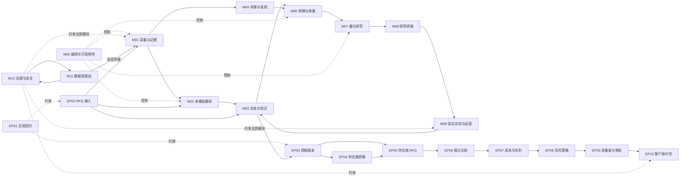

# 全球贸易 Alpha 基站 PoC：模块化架构规范

规范版本：`0.3.0`
基线日期：2026-08-27
用途：这是后续实现、评审和验收的唯一架构基线。聊天内容不是规范；如有冲突，以本目录中最新的已接受版本为准。

## 文档地图

| 编号 | 模块 | 规范 |
|---|---|---|
| M00 | 全局基线、边界与变更治理 | [00-global-baseline.md](00-global-baseline.md) |
| M01 | 来源登记、采集与不可变证据 | [01-ingestion-evidence.md](01-ingestion-evidence.md) |
| M02 | 网页、文档、OCR 与多模态解析 | [02-multimodal-extraction.md](02-multimodal-extraction.md) |
| M03 | 声明、实体解析、关系与知识层 | [03-entity-knowledge.md](03-entity-knowledge.md) |
| M04 | 存储、查询与 point-in-time 数据 | [04-storage-compute.md](04-storage-compute.md) |
| M05 | 数据转换、契约与质量发布 | [05-transformation-quality.md](05-transformation-quality.md) |
| M06 | 资产编排、重试、可观察性与恢复 | [06-orchestration-observability.md](06-orchestration-observability.md) |
| M07 | 特征、信号、回测与资源配置 | [07-quant-research.md](07-quant-research.md) |
| M08 | 研究终端、证据下钻与人工复核 | [08-research-ui.md](08-research-ui.md) |
| M09 | 研究任务、询盘、样品、订单与反馈 | [09-experiment-feedback.md](09-experiment-feedback.md) |
| M10 | 版本、许可、安全、审计与保留策略 | [10-governance-security.md](10-governance-security.md) |
| M11 | 数据源雷达、评估与受控入驻 | [11-source-discovery-onboarding.md](11-source-discovery-onboarding.md) |
| EP01 | 交易值对象、单位、币种与证据契约 | [EP01-transaction-contracts.md](EP01-transaction-contracts.md) |
| EP02 | RFQ 不可变证据接入与字段候选 | [EP02-rfq-evidence-intake.md](EP02-rfq-evidence-intake.md) |
| EP03 | 产品规格归一、冲突、门控与版本冻结 | [EP03-product-specification-versioning.md](EP03-product-specification-versioning.md) |
| EP04 | 供应商主档、能力声明与资格门 | [EP04-supplier-qualification.md](EP04-supplier-qualification.md) |
| EP05 | 供应商 RFQ 包与零外发演练 | [EP05-supplier-rfq-dry-run.md](EP05-supplier-rfq-dry-run.md) |
| EP06 | 供应商报价证据、归一化与可比性 | [EP06-supplier-quote-comparison.md](EP06-supplier-quote-comparison.md) |
| EP07 | 可追溯成本与毛利场景 | [EP07-cost-margin-scenarios.md](EP07-cost-margin-scenarios.md) |
| EP08 | 商业、安全与交易风险策略 | [EP08-commercial-risk-policy.md](EP08-commercial-risk-policy.md) |
| EP09 | 运营准备度与四眼审批 | [EP09-operational-readiness-approval.md](EP09-operational-readiness-approval.md) |
| EP10 | 客户报价包、沟通草稿与全链审计 | [EP10-customer-quote-package.md](EP10-customer-quote-package.md) |
| — | 跨模块验收追踪矩阵 | [acceptance-traceability.md](acceptance-traceability.md) |

机器可读的规范清单见 [spec-manifest.yaml](spec-manifest.yaml)。当前共定义 223 条模块验收标准和 20 条跨模块验收标准。

## 系统主链

## 规范的使用方式

1. 开始实现一个模块前，先冻结该模块的输入输出契约和验收编号。
2. 任何代码任务必须引用对应的 `Mxx-AC-xxx` 验收项。
3. 一个模块只有在其所有 `P0` 验收项通过并保存证据后，状态才能从 `Implemented` 变为 `Verified`。
4. 跨模块接口变更必须同时更新生产方、消费方和追踪矩阵。
5. 任何弱化验收阈值、改变数据语义或替换核心组件的决定，都必须写 ADR，不能只在聊天中口头改变。

## 状态定义

| 状态 | 含义 |
|---|---|
| Proposed | 已提出，尚未成为实现约束 |
| Accepted | 已成为架构基线 |
| Implemented | 已有实现，但尚未完全通过验收 |
| Verified | P0 验收通过，证据已归档 |
| Deprecated | 已由新版本替代，仍保留历史引用 |

M01–M11 与 EP01–EP10 已有通过终审的可执行 PoC；EP07–EP10 的实现、跨模块适配器、黄金场景
和反例回归已在 2026-08-27 验证。
生产持久化、真实 Docling Office 黄金集、生产身份提供商和任何真实外发适配器仍是部署门。
