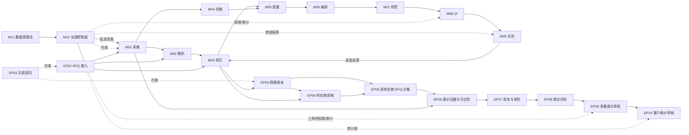

# Trade Alpha Station — M01–M11 + EP01–EP10 executable PoC

这是一个证据优先、point-in-time、可审计的全球贸易研究站参考实现。它把来源采集、多模态
解析、实体知识、Parquet/DuckDB 快照、数据质量、Dagster 编排、量化研究、研究 UI、有限实验和
治理安全和数据源发现拼成一条可运行的端到端路径。新增执行平面把买家 RFQ 接入、证据候选和
产品规格冻结、供应商资格、逐供应商 RFQ 沙箱、报价可比性、成本/毛利、风险策略、运营准备度
和客户报价草稿接到既有 M01–M03/M10 上。所有商业选择和三阶段批准都由人类显式完成，全程
不包含真实外联、订单、付款或出口动作。

- 详细架构：[docs/architecture.md](docs/architecture.md)
- 最终验收：[docs/acceptance-report.md](docs/acceptance-report.md)
- 数据源雷达：[docs/source-radar.md](docs/source-radar.md)
- 首轮产品—市场选择：[docs/product-market-selection.md](docs/product-market-selection.md)
- 过滤元件商业验证执行包：[docs/filter-elements-validation-pack.md](docs/filter-elements-validation-pack.md)
- 冻结规范：[../trade-alpha-poc-specs/README.md](../trade-alpha-poc-specs/README.md)
- 模型分工 ADR：[docs/adr/ADR-001-model-role-strategy.md](docs/adr/ADR-001-model-role-strategy.md)
- 产品—市场决策 ADR：[docs/adr/ADR-012-product-market-selection-gate.md](docs/adr/ADR-012-product-market-selection-gate.md)
- 首轮过滤验证 ADR：[docs/adr/ADR-013-first-filter-element-validation.md](docs/adr/ADR-013-first-filter-element-validation.md)
- 执行平面边界 ADR：[docs/adr/ADR-014-execution-plane-boundary.md](docs/adr/ADR-014-execution-plane-boundary.md)
- 开源复用门 ADR：[docs/adr/ADR-015-reuse-first-total-cost.md](docs/adr/ADR-015-reuse-first-total-cost.md)

## 架构一览



| 路径 | 已执行的主要开源组件 |
|---|---|
| 证据与解析 | Trafilatura、pdfplumber、RapidOCR、Pydantic |
| 实体与图 | RapidFuzz、NetworkX |
| 存储与质量 | PyArrow/Parquet、Polars、DuckDB、Pandera、Frictionless、dbt artifacts |
| 编排与研究 | Dagster、NumPy；StatsForecast/ruptures/skfolio 作为已锁定扩展依赖 |
| 交互 | Streamlit、Perspective |
| 治理 | hash-chain audit、RBAC、secret/archive/redirect/CSV guards、SBOM/license policy |
| 数据源发现 | CKAN Action API、APIs.guru、dlt connector draft、M10/M01/Golden gates |
| 商业执行内核 | Pydantic Extra Types ISO 4217、Pint、RapidFuzz、Jinja2 Sandbox、M01 Artifact、M02 blocks、M03 Claim |

## 本地运行

需要 Python 3.12 与 `uv`：

```powershell
uv venv --python 3.12
uv pip sync --python .venv\Scripts\python.exe requirements-dev.lock
$env:PYTHONPATH = "src"
.\.venv\Scripts\python.exe -m pytest --cov=trade_alpha --cov-report=term-missing -q
.\.venv\Scripts\ruff.exe check src tests apps
.\.venv\Scripts\mypy.exe src\trade_alpha
```

启动空数据安全入口：

```powershell
$env:PYTHONPATH = "src"
.\.venv\Scripts\streamlit.exe run apps\streamlit\app.py
```

UI 不计算评分；生产部署必须注入 published snapshot backend。空入口不会访问网络、发送消息或
创建订单。

## 目录

```text
src/trade_alpha/ingestion/       M01 不可变采集和来源 policy hook
src/trade_alpha/extraction/      M02 HTML/PDF/OCR 与 candidate claim
src/trade_alpha/knowledge/       M03 实体、关系、PIT view、PII
src/trade_alpha/storage/         M04 Parquet/DuckDB、原子快照与恢复
src/trade_alpha/quality/         M05 schema/PK/FK/PIT/waiver/lineage gate
src/trade_alpha/orchestration/   M06 Dagster graph、重试、backfill、runbook
src/trade_alpha/research/        M07 feature/score/backtest/allocation/live gate
src/trade_alpha/ui/              M08 evidence traversal、review CAS、export policy
src/trade_alpha/experiments/     M09 append-only experiment/action/outcome
src/trade_alpha/governance/      M10 license/RBAC/audit/retention/security/version
src/trade_alpha/discovery/       M11 catalog discovery/scoring/onboarding
src/trade_alpha/execution/       EP01–EP10 从交易契约到本地客户报价草稿的执行平面
configs/source-radar/            首批真实业务候选，全部默认禁用
configs/execution/               版本化产品族规格与 readiness 配置
tests/m01 ... tests/m11          各模块独立验收
tests/integration/               跨模块证据、快照、机会、实验和治理测试
artifacts/acceptance/            本次 PoC 验收索引
```

## 当前验证结果

2026-08-27 的当前基线为 `235 passed`；Ruff 全仓 clean，strict mypy 对 133 个 source files 通过，
`uv pip check` 验证 165 个已安装包兼容。EP01–EP10 的独立验收，以及三供应商 RFQ→报价比较
→成本→风险→M10 maker/reviewer/approver→客户本地草稿→全链 manifest 的黄金场景均在同一
环境通过。具体证据和生产边界见验收报告。

## 安全边界

这是可执行 PoC，不是已获许可的生产服务。所有真实来源、模型权重、个人数据和外部 connector
必须在 M10 登记并人工批准。付款、签约和订单承诺在参考 connector 中保持禁止；Admin 默认不是
Approver；受限读取与受限导出使用不同权限。
