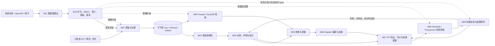

# Trade Alpha Station 端到端 PoC 架构

状态：Executable PoC 0.1.0  
日期：2026-08-25  
规范源：`../../trade-alpha-poc-specs/00-global-baseline.md` 至 `11-source-discovery-onboarding.md`

## 1. 总体结构

系统分为三个平面：

- 数据平面保存不可变证据、双时态事实、Parquet 快照和追加式业务结果。
- 计算平面执行解析、质量检查、受影响分区重算、PIT 特征、回测和评分。
- 治理平面在采集、读取、导出、审批、删除和版本发布处执行 deny-by-default 策略。

## 2. 模块边界与拼接方式

| 模块 | 输入 | 核心实现 | 对下游的冻结输出 |
|---|---|---|---|
| M01 | 已登记来源、API/网页/文件响应 | 许可 hook、分页 checkpoint、内容寻址、不可变 raw、quarantine | `RetrievalEnvelope`、`Artifact`、`BatchManifest` |
| M02 | M01 artifact bytes | 签名优先路由、HTML/PDF/OCR、block locator、claim schema gate | 版本化 extraction run、block、始终为 proposed 的 candidate claim |
| M03 | source record、claim、review decision | 稳定 ID、保守实体链接、冲突声明、可撤销关系、PII projection | PIT entity/relationship view、invalidation keys、图快照 |
| M04 | raw/gold rows、代码与配置版本 | PyArrow Parquet、Polars、DuckDB、原子 alias、hash 校验、备份恢复 | `SnapshotManifest`、published snapshot ID、PIT query boundary |
| M05 | 完整 M04 snapshot 与 M03 关系 | Pandera/Frictionless、DuckDB PIT、dbt 元数据和发布 gate | 通过 PK/FK/schema/waiver/lineage 的 published gold |
| M06 | asset inputs、质量状态、分区血缘 | Dagster asset graph、重试/terminal 分类、checkpoint、精确 backfill | `RunManifest`、issue、materialization、runbook rehearsal |
| M07 | mandate、universe、PIT feature inputs | registry lag、防未来泄漏、walk-forward、基线、透明评分、资源约束 | `ScoreBreakdown`、模型批准状态、bounded experiment plan |
| M08 | published score、evidence chain、review task | snapshot context、全链遍历、真实 Perspective、Streamlit、CAS review | UI view、`ReviewAudit`、受控 export audit、重算事件引用 |
| M09 | paper-approved plan、人工批准、预算 | 追加式状态机、并发幂等 action、stop gate、业务事件和 outcome | 冻结 experiment、attempt、event、negative/censored label |
| M10 | source/license registry、identity、resource/action | RBAC、数据分类、hash-chain audit、secret/恶意内容 guard、删除、SBOM | `PolicyDecision`、`VersionManifest`、tombstone、export receipt |
| M11 | CKAN/OpenAPI/种子目录元数据 | 安全发现、去重、revision、可解释评分、许可复核和 Golden gate | `SourceCandidate`、`PolicyReview`、`OnboardingBundle` |

跨模块不共享可变 Python 对象作为事实来源。传递的是带版本、snapshot、as-of、hash 和
owner 的契约；PoC 中部分 repository 使用内存实现，但接口按 PostgreSQL/对象存储替换边界设计。

## 3. 关键工程不变量

### 3.1 证据与时间

- retrieval 与 artifact 分离：重复访问可以增加 retrieval，但相同内容不复制 artifact。
- raw 只允许 create-once；解析和重解析不得覆盖原字节。
- M04/M05/M07 查询同时执行 `observed_at <= as_of`、系统版本和业务有效期约束。
- source local time 保留，系统时间必须是 UTC aware datetime。

### 3.2 发布一致性

- snapshot 先写 staging、校验 Parquet/hash/manifest，再原子推进 published alias。
- 读取 alias 后再次校验 immutable manifest 和文件 hash；Windows replace/read 竞争使用有界重试。
- incomplete upstream、schema/quality failure 或 terminal error 都不能推进 gold/UI publication。
- materialization identity 包含输入 ID/hash、代码、环境、配置和输出 hash，重跑可幂等。

### 3.3 研究正确性

- universe 只由 versioned mandate 配置决定，并记录每个纳入/排除理由。
- feature 的 registry availability lag 与实例 `available_at` 双重校验，伪造早到数据会失败。
- 评分只在 M07 计算；M08 原样显示保存的分项和 final score。
- 无 Alpha、负面实验结果和无响应都是合法输出，不允许因表现差删除样本。
- 总资本、研究工时、样品、单次损失、国家、HS 章节和探索份额先于排名执行。

### 3.4 外部动作与安全

- M07 的 plan 不是发送授权；M09 还要求冻结预算、止损、owner、term 和独立人工批准。
- Admin 默认不是 Approver；UI、M09 service 和 M10 policy 三层均执行职责分离。
- restricted raw read 与 restricted export 是两个独立 grant，不能用读取权限旁路导出。
- 外部 connector 以 idempotency key 加锁保留；并发重试只产生一次副作用，attempt 全部保留。
- prompt injection 作为数据隔离；zip bomb、路径穿越、SSRF redirect、CSV 公式和 secret export 在边界阻断。
- 数据源发现只访问 allowlisted HTTPS 目录元数据；候选、评分和 connector 草案都不构成商业使用授权。
- M10 批准后仍不正式调度；M05 Golden 小样本通过后，M11 才能把 M01 record 从 disabled 改为 enabled。

## 4. 数据与服务部署拓扑

生产化时建议保持以下物理隔离：

1. Collector worker：按来源独立 service account，只能写 raw/object manifest。
2. Extraction worker：数字 PDF/HTML 用 CPU pool，OCR/模型增强用单独可限额 worker。
3. Object store + Parquet lake：raw 与 bronze/silver/gold 使用不同 bucket/prefix 和保留策略。
4. PostgreSQL：只保存 source registry、review、task、experiment、RBAC 和 audit 等事务状态；大历史事实不写操作表。
5. Dagster control plane：只通过 asset contract 调度，不能直接绕过发布 gate。
6. Research/UI service：DuckDB 读取 published snapshot；raw 必须通过 M10 protected gateway。
7. Governance service：许可、身份、secret、审计、保留和导出策略作为共享 control plane。

## 5. 一次端到端事务

1. M11 从开放目录和种子发现候选，安全探测、去重、版本化并按业务价值排序。
2. M10 人工登记 API、数据商业用途、缓存、保留和再分发；不完整时 M01 connector 调用为 0。
3. M11 生成 disabled connector；M05 Golden 通过后才允许启用 M01。
4. M01 获取内容并提交 retrieval/artifact；非法 MIME、截断或错误页进入 quarantine。
5. M02 生成可定位 block 和 proposed claim；人工决定追加，原 proposed 内容不覆盖。
6. M03 解析实体/关系并保留冲突；撤销错误链接产生精确 invalidation keys。
7. M04 构建新 immutable snapshot；M05 对 schema、PK/FK、PIT、质量例外和 lineage 执行发布 gate。
8. M06 只重算受影响分区，并保存完整 run manifest、issue、checkpoint 和 runbook 证据。
9. M07 在固定 as-of 下计算特征、基线、分解评分和受约束资源计划。
10. M08 在同一 snapshot context 下显示 score→feature→claim/fact→artifact 链，并以乐观锁记录 review。
11. M09 只对 paper-approved、有限预算且人工批准的动作调用 connector；失败/无响应同样进入 evaluation。
12. M10 为发布、角色变化、受限读取、导出、批准和删除生成 hash-chain audit 与 version manifest。

## 6. PoC 与生产边界

本仓库证明可执行契约、故障语义和本地集成路径，不宣称已完成生产基础设施。以下仍是部署任务：

- 将内存 review/experiment/audit repository 替换为带唯一约束和事务的 PostgreSQL 表。
- 将本地文件湖替换为对象存储、DVC/版本目录和跨区域备份，并完成真实 RTO 演练。
- 为 dlt/Scrapy/Playwright、Docling/PaddleOCR/Splink/OpenLineage 和外部 CRM 建立部署 profile。
- 在目标硬件与代表性真实数据上完成 M01/M04/M08 性能、OCR/多语言 Golden 和安全扫描基线。
- 对每个真实来源、数据集、模型权重和部署方式进行人工许可/合规审批；代码不能代替法律判断。
