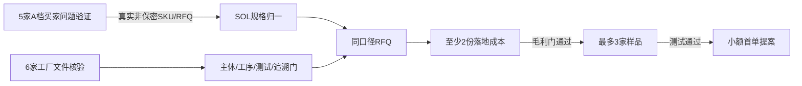

# FE-EU-001：过滤元件商业验证执行包

版本：`0.1.0`  
日期：2026-08-25  
所有者：SOL  
状态：公开研究和执行准备完成；外联、RFQ、样品和报价尚未授权/发生

## 1. 本轮完成结果

- 建立德国 20 家、荷兰 10 家买家候选池；
- 从宽泛过滤行业中重新筛出 5 家严格 A 档和 3 家 A 档候补；
- 建立中国 12 家制造候选池，并把只有官网自述的工厂降级；
- 将主产品收紧为一般制造业非有毒、非可燃干粉尘用除尘滤筒；
- 完成欧盟归类、REACH、CE/GPSR 边界、德国/荷兰包装 EPR、进口 VAT 和运输输入清单；
- 生成买家问题访谈邮件、中文工厂文件核验信、SKU RFQ、样品验收和落地成本模型；
- 没有联系任何公司，没有产生报价、订单、认证或付款。

## 2. SOL 收紧后的产品定义

| 子类 | 决策 | 允许范围 |
|---|---|---|
| 一般工业除尘滤筒 | 主线 | 非有毒、非可燃干粉尘；普通制造、打磨、喷涂等在完成粉尘问卷后的低风险场景 |
| 一般工业空气滤芯 | 挑战者 | 非呼吸防护、非消防、非洁净关键、非带电整机 |
| 润滑/回油滤芯 | Buyer-led | 不构成压力边界、非危险介质；只有收到明确规格后启动 |
| 一般工业液体滤芯 | 储备 | 非食品/饮水/医疗/危险介质；只有收到明确规格后启动 |

所有可燃粉尘、毒性粉尘、ATEX、防爆、食品、饮水、医疗、呼吸防护、消防、压力壳体、危险介质、
完整电气/机械设备均直接退出。配置基线见
`configs/commercial-validation/filter-elements-v1.yaml`。

## 3. 买家候选结果

完整 30 家名单、证据和红旗见
`artifacts/research/filter-elements-validation/2026-08-25/buyer-pool.yaml`。

### 第一批严格 A 档

| 顺序 | 买家 | 国家 | 为什么进入 | 进入前仍要问什么 |
|---:|---|---|---|---|
| 1 | DSI Filters B.V. | NL | 官网明确为新旧第三方除尘系统提供替换元件，可按型号/照片报价并做检查维护 | 是否接受新外部工厂、哪些非危险型号缺货、测试准入方式 |
| 2 | FILTERON GmbH | DE | 官网有工业除尘滤筒、按应用/尺寸询价和多种制造业场景 | 自制/外采边界、一般粉尘 SKU、私标或第二来源意愿 |
| 3 | EFC Industrial Filtration B.V. | NL | 官网声明所有品牌/类型替换滤芯、库存、安装维护，并存在采购条款 | Parker授权与外部非Parker供应边界、普通粉尘产品缺口 |
| 4 | EURO-Filter GmbH | DE | 官网要求固定、密封、内外径等参数以提供原装适配脉冲滤筒 | 是否接受按图外部生产及供应商质量文件要求 |
| 5 | Nedfilter B.V. / Vlint | NL | 标准/定制滤芯、安装、维护、再生和历史订单流程 | 自有生产与外采边界；排除ATEX和特殊行业后的采购缺口 |

SOL 独立抽查确认：

- [DSI](https://dsifilters.nl/infastaub-filterinstallaties/) 的一手页面明确提供旧设备替换元件、型号/照片
  识别、报价和检查服务，并公开法定主体、地址及 KvK；
- [FILTERON](https://filteron.de/produkte/filterpatronen) 明确列出除尘滤筒及按数据表定制；
- [EFC](https://www.efcfiltration.com/nl/) 明确声明供应各种品牌和类型的替换滤芯、库存和维护；
- [EURO-Filter](https://www.euro-filter.de/product/filterpatronen/) 明确要求安装、密封、长度和直径数据以
  提供适配件。

这些证据证明它们经营相关业务，不证明它们愿意采购中国产品。第一封信的目标是验证采购问题，
不是推销产品目录。

### A 档候补

- Detzel Filterservice：产品/维护适配强，法定形式需补；
- Richters Filter / Ernst Schmidt GmbH：第三方设备替换和维护适配强，注册细节需独立核对；
- Holt Filter：工业除尘替换、测量和安装适配强，需确认官网所列 KvK 对应的完整法律名称。

因此，目前达到严格 A 档的是 5 家，不是预设验收门的 10 家。不能为了凑数量把液压经销商、大型
OEM 或自有制造商等权升级。

## 4. 中国工厂候选结果

完整 12 家池见
`artifacts/research/filter-elements-validation/2026-08-25/supplier-pool.yaml`。

### 文件核验顺序

| 顺序 | 候选 | 公开证据判断 | 当前状态 |
|---:|---|---|---|
| 1 | 石家庄一通过滤器设备制造有限公司 | 官网制造/产品迹象 + 外部专利记录出现复合过滤筒 | 研究 A；未通过文件门 |
| 2 | 新乡市中汇过滤技术有限公司 | 产品与工序最贴近折叠空气/阻燃滤筒 | B+；独立来源不足 |
| 3 | 广东志远环保设备有限公司 | 政府环评直接披露滤筒项目、厂址和设备 | B+；需确认投产、产品和联系主体 |
| 4 | 江阴市人和环保设备有限公司 | 产品匹配很强，公开描述覆膜/聚酯/焊烟/脉冲滤筒 | B；只有单一公开来源 |
| 5 | 华滤环保（广州/广东主体待理清） | 折叠工业除尘滤筒方向匹配 | B+；法律主体和独立证据不足 |
| 6 | 新乡市元亨机械有限公司 | 外部展商/项目证据较强 | 研究 A；但干式完整滤筒匹配较弱 |

“研究 A”只表示值得先索取文件，不表示已审厂。SOL 抽查发现，石家庄一通的外部专利记录确实列出
公司和复合过滤筒，但专利本身不能证明当前产能；元亨的独立展商资料更偏机械加工、紧固件和多品类
制造，不能把“经营过滤器”外推为有完整除尘滤筒产线。

当前通过主体、厂址、目标工序、测试、追溯和变更控制文件门的工厂数量是 **0**。这项只能通过
企业回传文件、签发机构核验、视频/现场验厂和样品得到，不可能靠公开搜索替代。

## 5. 海关和合规结论

`842199` 仍只是需求统计代理，不是最终欧盟归类。具体 SKU 必须回答它是完整过滤装置、专用零件、
通用滤材还是其他物品，再用 [EU TARIC](https://ec.europa.eu/taxation_customs/dds2/taric/taric_consultation.jsp)
核验十位编码、当日税率、中国原产地措施及贸易救济；在没有具体 SKU 前不填写虚构税率。

冻结范围内的独立普通滤芯一般不因自身贴 CE，但用途和组合改变后必须重判；官方原则见
[欧盟 CE 说明](https://europa.eu/youreurope/business/product-rules-compliance/general-product-compliance/ce-marking/index_en.htm)。
滤材、胶黏剂、涂层、端盖、护网和密封需做
[REACH/SVHC](https://echa.europa.eu/regulations/reach/candidate-list-substances-in-articles) 材料披露。

德国首次投放包装需要确认 [LUCID 登记](https://www.verpackungsregister.org/en/registration/find-out-about-registrations)、
系统参与和数量报告责任；荷兰也需根据进口商、包装类型、重量和投放角色确认 EPR。德国标准进口
VAT 为 19%，荷兰一般 VAT 为 21%；它们先作为现金流项目，是否可抵扣不能预设。

机器可读结论和成本字段见
`artifacts/research/filter-elements-validation/2026-08-25/compliance-and-cost.yaml`。

## 6. 不编造价格的落地成本模型

```text
出厂前成本
= 产品 + 内外包装 + 标签/文件 + 模具摊销 + 工厂检验 + 第三方验货

到门现金成本
= 出厂前成本 + 中国内陆/出口费用 + 国际运输/保险
 + 目的港/清关/仓储/派送 + 关税 + 不可抵扣税

完全项目成本
= 到门现金成本 + 包装EPR/合规 + 汇率/资金/坏账
 + 不良/返工/补发/质保/召回预留

单位完全成本 = 完全项目成本 ÷ 可销售数量
贡献毛利率 =（售价 - 单位完全成本）÷ 售价
```

通过线仍为：基准情景贡献毛利率不低于 18%，运费、汇率和不良率压力情景不低于 10%。当前没有
真实买家 SKU、工厂报价和货代报价，所以利润门状态是 `not tested`，不是失败，也不是通过。

## 7. 获批后的执行顺序



控制规则：

1. 第一波只发 5 个买家问题验证和 6 个工厂文件核验；
2. 不向工厂透露买家公司、联系人或完整商业背景；
3. 没有买家规格时，不要求工厂报“万能价格”；
4. 文件未过门的工厂不得拿到正式 RFQ；
5. SKU 未完成 TARIC/用途核验时不得给买家落地价；
6. 样品、测试、运费和任何协议再次单独审批。

买家英文/德文/荷兰文草案见 `docs/templates/filter-elements-buyer-discovery.md`；工厂中文文件核验及
RFQ 见 `docs/templates/filter-elements-supplier-rfq.md`。

## 8. 验收状态

| ID | 验收项 | 结果 |
|---|---|---|
| FE-AC-001 | 德国20家、荷兰10家买家候选，均有公开业务证据 | 通过 |
| FE-AC-002 | 至少80%有公司官网一手证据 | 通过 |
| FE-AC-003 | 10家严格A档买家 | **未通过：5家，另3家候补** |
| FE-AC-004 | 中国12家制造候选，区分独立证据与官网自述 | 通过 |
| FE-AC-005 | 至少5家通过主体/厂址/工序/测试/追溯文件门 | **未通过：0家，需外联取证** |
| FE-AC-006 | RFQ、样品、红线、合规和成本字段完整 | 通过 |
| FE-AC-007 | 具体SKU十位TARIC、税率和贸易措施确认 | **未通过：尚无SKU** |
| FE-AC-008 | 至少3个买家问题、1个真实RFQ | **未通过：尚未外联** |
| FE-AC-009 | 至少2份同规格落地成本、毛利门通过 | **未通过：尚无报价** |
| FE-AC-010 | 未经授权不产生外部状态变化 | 通过：0条消息、0次付款、0份承诺 |

结论：下一阶段的“公开研究和执行包”已经完成；真正的商业验证必须由外部回复产生，不能靠继续
搜索伪造。下一步唯一合理的状态变化，是在明确发件身份和发送渠道后，由人工批准第一波 11 个
对象的外联。

## 9. 模型分工审计

- SOL：收紧产品、打回低质量证据、定义A/B/C和硬门槛、重排买家/工厂、复核关键官网、制定执行
  顺序和验收结论。
- Terra：批量搜集30家买家并二次补齐目标产品、主体和联系证据。
- Luna：批量搜集12家工厂；首版因单一官网和产品偏移被打回，第二版按独立证据和干式滤筒重做；
  另一任务整理欧盟税则、法规、EPR、VAT、RFQ和成本字段。

子智能体没有决定A档门槛、最终外联序列或放宽任何红线。

