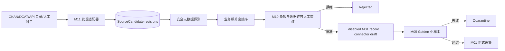

# 商业数据源雷达：开源组合与接入方案

日期：2026-08-25  
状态：M11 executable PoC  
冻结规范：`../../trade-alpha-poc-specs/11-source-discovery-onboarding.md`

## 1. 结论

这不是一个“全网爬虫”。它是一个受控的数据源供应链：



自动化负责找、去重、体检、排序和生成草案；人只集中处理高价值候选的商业用途、缓存、
保留、再分发和地区限制。发现目录、OpenAPI 定义、软件代码与目标数据的许可证始终分开。

## 2. 开源项目如何分工

| 层 | 项目 | 可复用能力 | 本项目决策 |
|---|---|---|---|
| 外部开放目录 | [CKAN Action API](https://docs.ckan.org/en/latest/api/) | 用统一 `package_search` 扫描大量政府/机构数据门户 | 已内嵌轻量 adapter |
| 目录联邦 | [ckanext-dcat](https://github.com/ckan/ckanext-dcat) | DCAT-AP v1/v2/v3、RDF 导入导出和 harvester | 不在 PoC 部署；需要完整 DCAT 联邦时再启用，AGPL 单独评审 |
| 大型联邦目录 | [Magda](https://github.com/magda-io/magda) | 快速 crawl 外部目录、变化跟踪、自动增强、OpenSearch | 500+ 候选或跨团队时再部署；当前过重 |
| 公共 API 目录 | [APIs.guru OpenAPI Directory](https://github.com/APIs-guru/openapi-directory) | 公共 API OpenAPI 定义、REST 目录、自动更新与验证 | 已内嵌 adapter；定义许可绝不外推为数据许可 |
| Connector 生成 | [dlt REST/OpenAPI](https://dlthub.com/docs/dlt-ecosystem/verified-sources/openapi-generator) | 从 OpenAPI 生成 REST pipeline，推断分页、主键、认证和 endpoint 关系 | M01 的首选 connector 草案目标 |
| 大型连接器库 | [Airbyte](https://docs.airbyte.com/) | 数百来源到仓库/湖的复制连接器 | 仅在已有 connector 明显降低维护成本时引入 |
| 内部资产目录 | [OpenMetadata](https://docs.open-metadata.org/latest/connectors) | 数据库、API、存储、pipeline、质量、血缘和自定义 connector 元数据 | 不是外网找源器；多团队治理阶段再接 |
| 内部资产目录 | [DataHub ingestion](https://github.com/datahub-project/datahub/blob/master/metadata-ingestion/README.md) | pull/push metadata、血缘、owner、tag 和大量来源 | 与 OpenMetadata 二选一，不在 PoC 双栈部署 |
| 采购专项 | [OCDS Kingfisher Collect](https://www.open-contracting.org/data/data-use/) | 从发布者 API/批量下载统一收集 OCDS | 当采购信号成为主策略后接入 |
| 风险专项 | [OpenSanctions 开源组件](https://www.opensanctions.org/docs/opensource/) | `zavod` 采集、`yente` 匹配、FollowTheMoney 数据模型 | 代码可复用；其聚合数据商业使用需付费许可，当前改接官方名单 |

推荐的当前组合是：

```text
CKAN + APIs.guru + curated seeds
                ↓
       本仓库 M11 candidate registry
                ↓
       M10 review + dlt connector draft
                ↓
          M05 Golden → M01
```

它复用开放标准和 connector 生成能力，同时避免为了十几个来源先运行 Kubernetes、OpenSearch 和
两套 metadata catalog。

## 3. 首批业务候选

配置文件：`configs/source-radar/initial-sources.yaml`。所有候选默认 `DISCOVERED`，没有自动批准。

| 数据域 | 首批来源 | 能回答的业务问题 | 当前许可处理 |
|---|---|---|---|
| 贸易流 | UN Comtrade | 哪个 HS×国家的进口规模、增速、伙伴结构发生变化 | 免费层有调用限制；条款人工复核 |
| 贸易流 | Eurostat Comext | 欧盟详细贸易、产品、伙伴与部分企业特征 | 多数统计可商用，但存在非欧盟申报国、瑞士/列支敦士登及奥地利 CN8 等例外 |
| 贸易流 | U.S. Census International Trade API | 美国 HS×国家×港口×州的月度进出口 | API key、自动访问和再分发条款复核 |
| 企业主体 | GLEIF LEI API | 买家/供应商标准身份、注册 ID、父子关系和模糊名称匹配 | 官方条款声明数据 CC0；仍保存审核凭证 |
| 企业信号 | SEC EDGAR | 上市公司业务、资本开支、风险、产品和扩张事件 | 无 API key；必须遵守 automated access/User-Agent 规则 |
| 采购需求 | TED Search API | 欧洲政府买家正在采购什么、何时、在哪里、谁中标 | 官方明确支持分析、复用及商业集成；仍审 legal notice |
| 采购目录 | OCP Data Registry | 50+ 发布者的全球 OCDS 招标、合同与中标数据 | 每个发布者/数据集许可证分别审核，不能用 Registry 的 CC BY 覆盖全部 |
| 风险 | OFAC Sanctions List Service | 美国 SDN/非 SDN 实体、船舶、飞机风险 | 官方名单直连；保留条款与更新时间证据 |
| 风险 | UN Security Council Consolidated List | 联合国制裁实体和个人 | XML/HTML 官方源；UN 网站条款审核 |
| 风险 | UK Sanctions List | 英国制裁实体、个人和船舶 | 官方 CSV/XML；OGL 及具体使用边界审核 |

为什么暂不把 OpenSanctions 聚合数据作为免费生产源：其软件组件采用 MIT，但官方明确说明，
营利企业使用聚合数据需要商业许可。当前用 OFAC、UN、UK 等官方列表降低起步成本，但官方名单
并不等于完整 KYC/AML 服务，实体消歧与适用法律仍需人工负责。

## 4. 数据合同与状态机

`SourceCandidate` 保存：稳定 candidate ID、canonical URL、目录 provenance、publisher、业务域、
分发格式、覆盖地域、更新频率、认证方式、条款 URL、许可证声明、证据 URL、metadata hash、
首次/最近发现时间和 revision。

```text
DISCOVERED → PROBED → POLICY_PENDING → APPROVED
                                      ↘ REJECTED
APPROVED → CONNECTOR_DRAFTED → GOLDEN_VALIDATED → ENABLED
```

关键规则：

- 高优先级分数只改变评审顺序，不改变许可状态；
- 新来源产生的 M01 `SourceRecord` 永远是 `disabled`；
- M10 政策批准后仍保持 disabled，直到 Golden 的 schema、主键、freshness 和样本证据全部通过；
- 条款、license evidence 或 metadata 发生变化，已启用候选退回 `POLICY_PENDING`；
- 被拒来源不能靠再次被目录发现而自动复活；历史 revision 不删除。

## 5. 如何扩展

新增一个开放数据门户时，只需要配置允许的目录 host 并使用 CKAN adapter；新增非 CKAN 标准时，
实现返回 `SourceCandidate` 的 adapter，不允许 adapter 直接创建 enabled M01 record。

```python
policy = ProbePolicy(allowed_hosts=("catalog.example.gov",))
fetcher = SafeJsonFetcher(policy)
candidates = CKANAdapter("https://catalog.example.gov", fetcher).discover(
    "international trade", max_results=50
)

for candidate in candidates:
    registry.upsert(candidate)
    score = score_candidate(candidate, ("trade", "procurement", "buyer"))
    draft = draft_source_record(candidate, owner="data-platform")
    assert draft.status == "disabled"
```

生产部署应把 candidate revisions、PolicyReview 和 GoldenValidation 存入 PostgreSQL，并由 Dagster
定时运行发现和变更检测。发现器的网络账户只需要读取目录元数据，不能持有业务 API secret。

## 6. 升级触发器

- 候选 < 500、维护者 1–2 人：继续使用当前轻量 M11；
- 候选 ≥ 500 或 3+ 团队共同维护：评估 Magda；
- 内部表/API/pipeline 的 owner、质量、血缘成为主要问题：OpenMetadata/DataHub 二选一；
- SaaS/数据库 connector 数量快速增加：评估 Airbyte；
- OpenAPI API 成为主要来源：将 `dlt-init-openapi` 纳入 connector build job；
- 采购数据成为主要 Alpha：接 Kingfisher Collect 与 OCDS schema validation；
- 需要统一全球制裁/PEP 与 SLA：为 OpenSanctions 或其他合规供应商做正式采购评估。

